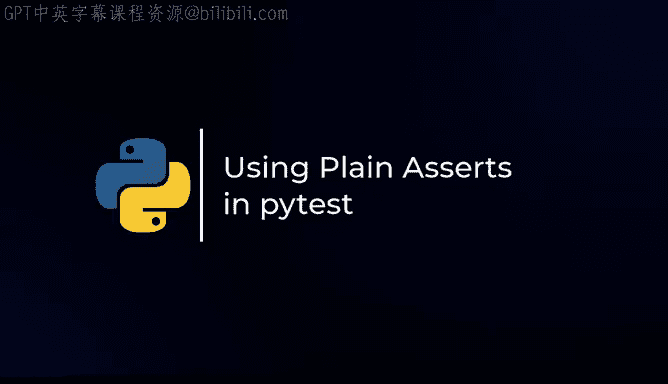
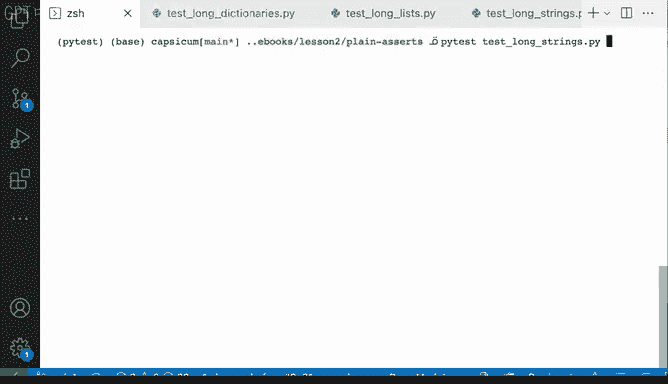

# 杜克大学《MLOps ｜ 机器学习运维（Python基础）｜MLOps ｜ Machine Learning Operations》 - P43：43_03_03_在pytest中使用断言计划.zh_en - GPT中英字幕课程资源 - BV1kw4m167aV

。

You for me say before that using plane Ass Python in Pytees specifically it's very good and you shouldn't be worried about using plane Ass Now I have a terminal here。

 I have my py test a virtual environment activated py test is alreadyinstalled and it's ready to go but I have three example。

Fileles where I want to show you how these works。 So I have Te long dictionaries。

And in this test function I have a result and an expectation。

 so the thing is that sometimes with testing you need to compare very large， very dense。

 fully populated objects or data structures like dictionaries。

And using an assert plane assert with byte would be just really wonderful because it doesn't matter where the difference is and actually right here。

 it's pretty difficult to tell what the problem is and you might get a hint because the a is highlighting already。

But let's take a look what happens when we have these two these results and this expectation and we want to make sure that these both are fine。

 so I'm going to run that on with pi test I'm specifically going to ask for test I don't want to run everything Im going to run just the dictionaries example and I'm going to run these and I'm going to get a failure which I was expecting because I want to show you these in the failure area we get we get the last the left contains one more item it says last name is dea and the right contains one more item last aim so kind of tricky key to tell kind of tricky to tell because the key is different So it's telling you like hey。

 these two keys are the the one keys the one key that is different on both sides and then it oms everything you can see here ottting two identical items but what if we。

Really wanted to show that well let's just use more flags here and run that and I've run with dash VV if I went too fast for you you can see here that is running the full diff engine on it and you can see here that it will put both dictionaries one above the R1 and you can see here there's this little addition or plus character and that's because it has an n and the R1 doesn't。

And that's just with plain asserts。 Now that's great。 let's take a look at long lists。

 so long list is similar like you have an RNA structure。

 What happens when you have something that they look exactly the same and you can tell what is going to be different so I'm going to go back to my terminal I clear here Im I say pi test I I say test long lists I'm going to run these and similarly pi test is going to report hey。

 you have a。😊，A something that is not quite right at index2。

 that means it recognizes that is a list and remember we saw lists before when we were looking at different types of data structures like list lists have an index。

 they start at zero， so index 2 means the third item。And the third item。

 you can see here that these are not the same。 So it tells you exactly exactly where these thing that is not quite right is the problem。

 Use dashv to get more di like if you want to have more more of avo output I'm going to use dashv and you can see now that the output is exactly telling you what some of the other things that might be in the list that were previously omitted and then lastly。

 and this is true for every single data structure in Python if you have custom data structures。

 it might not necessarily do this for you， you'll have to do some more things but right from the getgo is pretty useful Now finally long strings similar we have a long string want to compare the long string as my expectation I don't know if these two will be will be right so let me go back to my terminal and test them and see what happens so by test。

Test long strings and run that and and it's a string。

 it's very long and Pythte had no problem finding what the thing is different in here have a caing casing problem this is a very long and just the beautiful thing is that it also creates a subset of the data that I'm passing that I'm testing its comparing both and it's showing me exactly what I need as as an engineer to go and quickly fix it so there you go those are three very powerful examples it will work with all data structures。

 Piyte will show you exactly what you need and it will give you the ability to understand where the failure is so that you can go and fix it。

