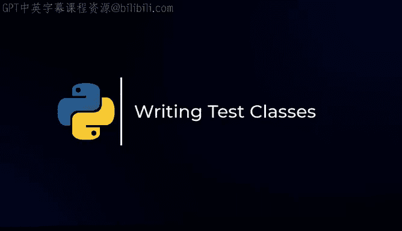
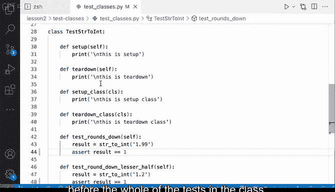

# 杜克大学《MLOps ｜ 机器学习运维（Python基础）｜MLOps ｜ Machine Learning Operations》 - P44：44_03_04_编写测试类.zh_en - GPT中英字幕课程资源 - BV1kw4m167aV

。

So far we've seen test functions， but I haven't touched yet on test classes。

 test classes are also useful if you want to use them and group your tests together and we'll see some of the deciding factors that you can use to use either a test function or a test class。

But I want to show you more like a real world example here。

 we have this function that is string to int， it converts strings to an integer。

 so if you're passing like say a string that is 1。1 will a 1。So that' that's great。

 And we want to run some tests。 Now you can definitely do this with just plain functions in P test but I'll show you a test class。

 So here we have a test string to end you don't you don't necessarily need to name a string to end you can name it anything it has to be perfect fixed like with test as I show you before but this thing has a lot of different things in here and we don't know exactly what's going on。

 Well the thing is that this is one of the things that classes allows you to do which is to do some prework before every single test starts and let's break it down by by method So setup will run。

Before every single test in a test class。Teardown will run after every single test in a test class。

 regardless if it passes， fails， or has a bug， or has like an exception throws an error。

Set up class or set underscore class。Will said we'll run once before every test in in the test class and you can see here that I'm not using self I'm using CLS that is normal and that's how this thing works and is required and similarly tear down underscore class will run once after all of the tests run in a given class now I have two tests here to demonstrate one is test around down I'm making sure that 1。

99 will be will be a2 and a test round down lesser half 1。

2 is2 now there's a bugging here that't matter I still want to show you how this works on the terminal so I'm going to run test classes here have again pi test install this this is my terminal and I'm going run you have test classes in there I'm going to say pi test。

T underscore classes and want to see what's going on。Alright。

 so I'm gonna scroll all the way up here and you can see that both tests failed that's fine I was expecting that tells me what the failure was and you can see here that the standard out from the setup from the class setup is there and then capture standard out from the tear down was also what also there now it also captures the whole thing pair per per test so you can see certain things are running and outputing getting some output out while they're running so let's go step by step here so this is a setup class perfect runs just once before all of the tests。

And then it runs setup because it's going to run this test of test runs down。

 then it runs the test runs down， it fails， and then it runs this ist down。

 then it goes on the next test， and it runs this is setup， it no longer runs setup class。

 then runs the test， it fails， runs stare down and then finally runs tear down class。

Those are there to give you flexibility on a setup or on tear down tasks that that your tests might need or or might might benefit from let's make these things pass this is going to be a one and this is also going to be a one I'm going to save these I'm going to run this again and we'm going to have some passing know that when everythings passing。

Pine test will eat out or will om showing you the output。

 which is also benefit because if everything's passing。

You do not need to deal with a wall of text when things are failing you definitely want to understand why things are failing and what the output is。

 so this is a good way of coordinating what's happening here and you have options to do certain things before every test or before all of the test in a class or after each test or after all the tests in a class。

