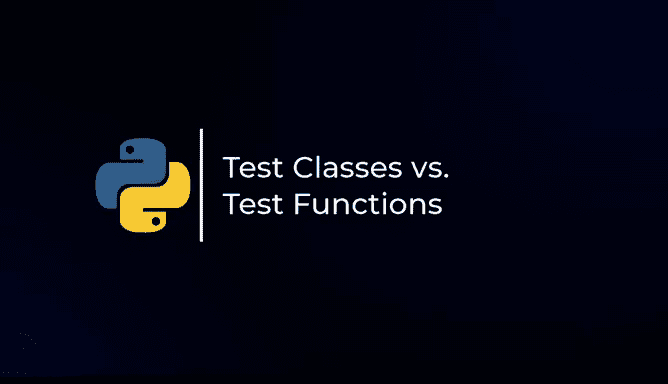
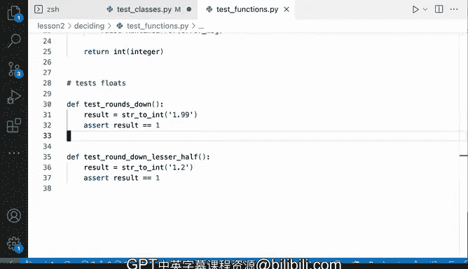

# 杜克大学《MLOps ｜ 机器学习运维（Python基础）｜MLOps ｜ Machine Learning Operations》 - P45：45_03_05_测试类与测试函数对比.zh_en - GPT中英字幕课程资源 - BV1kw4m167aV

。

Now that you've seen both ways of writing tests in byte or with byte both functions and classes you might be wondering like well when do I use a function versus using a class what is best well it's up to you to the side I generally recommend test functions because they're easy to deal with and they're more straightforward but if you need to group some tests then definitely you'll need some you can use not need。

 youll definitely can use and group those tests within a class。

 especially if they need a common setup or tear them but going back to our our tests files here。

 we have test functions and here I'm testing some floats operations these should be one and those should pass that's fine but so I have two functions and if I go to classes same thing and I might just these string to in function。

because tests should go with along with the production good but just out of convenience so I don't need to install a package or do any imports so I'm going to scroll down and you can see the floats well just like before we have set up tear down set class and tear down class。

This is a telltale because if you require to do a setup。

 it is easier to write this code once and do them for all of the tests inside the class than having to do some sort of setup within a function。

 so this gives you the flexibility of grouping them and writing the code for the setup and turn on just once。

The other thing is that you know how this is testing floats because if I go here is the same is 1。

99 and 1。2 well I could I could start grouping them by that type of test so I can say string to in floats and I could do that and then these would fail because these are two and this is one all right so that would work and if I save that that would work。

 but it gives me the ability to also separate them and say well what if what if I want to do some string to int and I can say integers and then write some sample tests here and then pass now I could just focus on integers only and floats on some other class Why would you want to do that it's just a way of organizing your。

And it is not a requirement。 It is not mandatory。 It is up to you on how you organize your things in this case。

 well I tend to go with what feels better， especially when you want to deal with a failure。

 Think about when this thing fails， there's a test string to in floats。

 This is already hinting that is testing the the string to int。Function and just a floats condition。

 So it's testing these strings that look like floats。 So again。

 those are perfectly valid when I started working with Python classes were intimidating and I was forced to use Unies because I didn't know anything else Py test came along and you have the opportunity to write functions and functions are way more straightforward than classes so is this is a strong benefit to just writing functions and it's perfectly fine if all you want to do is just write functions So those are some of the reasons why you may want to use a class or you may want to use functions instead。

