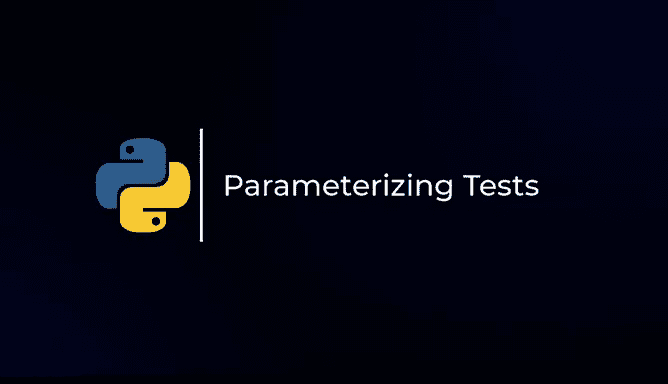
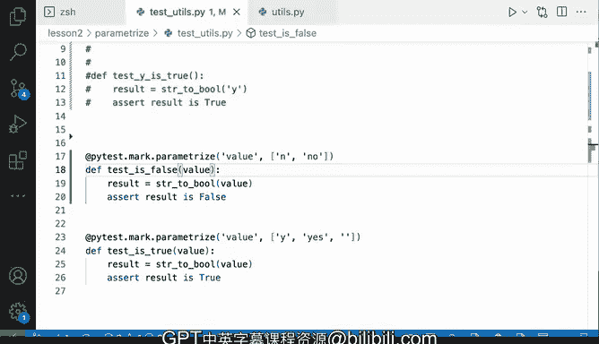

# 杜克大学《MLOps ｜ 机器学习运维（Python基础）｜MLOps ｜ Machine Learning Operations》 - P46：46_03_06_参数化测试.zh_en - GPT中英字幕课程资源 - BV1kw4m167aV

。

One of the features of Pyteas that I really like is using paratris Now it sounds intimidating。

 Paraizing sounds like something that is really complex。

 but I'll show you one of the benefits in how to tell when to use it and how you can very easily in a very straightforward way you can implement it in your test and make them really nice So I have a utility here called a string tooo it basically takes in a string a value and it has these values that if they are yes y or empty we'll return it true and if it's no or n as a string it will return a false so that's it I'm going to run some tests and do these now I'm calling these test u so I'm going have to import string tooo from us and have two functions over here。

One is test underscore yes is true and the other one is test underscore Y underscore is true。

 So this is kind of common where you have multiple different tests that they are all doing the same assertion The assertion is that the result is true。

 their testing various different inputs that at the end of the day should give the same result。

 So if I go and show you u once again。All of these values will be will get you a true a responsive true。

 so you have to write three tests to cover this condition now sometimes people are ten。

 engineers are tempted to do something like4 for value in you know yes。

 why and what the are1 empty then do an assertion right third。And then but the problem。

 the problem with that is that if you're running a test and say you get into a failure when it hits y。

 then you don't know if yes past or this one's still pending or if or if all of these are wrong and it's just failing on the first one。

 even worse if this one which is the first item fails。

 you don't really know if you're fixing if your fixes are going to cover all of the rest。

 so you should not you should not do a for loop in a unit test because the failures are not going to show you every single permutation。

 every single item in your for loop， it's just going to fail on the first it's going to stop on the first failure not going to show you everything。

So what you're ending up with is a test that looks like these that is similar to this or test that is here in line 11 with the same assertion line 13 and line 8 are the same assertion。

 So if I run these you have yes and why but then again I'm missing I'm missing this one so instead of writing that one I'm going to use pararies I'm importing pi test now I'm going to use the framework beats and pieces from pi test which I wasn't using before。

 this is entirely optional up to you you want to use the framework parts of of p test but it's extremely useful and I'm excited to show you how that works I'm going scroll away down here I pushed it all the way to the bottom so you wouldn't see and I wouldn't give it away but you're going to use these weird notation that if you haven't especially if you haven't work with decorators before just think away of p test having a way to wrap around your function and give you some extra capabilities So what we're doing。

Here is we're doing Pyte。 mark。That parametermets， and then I'm going to open up parentheses。

 I'm going pass this string called value and then I'm going to pass all of the values that I want to like the itable。

 So in this case is y yes and empty string and those are going to be injected into my test function and I'm using value here because that's the way pi test knows that this string of values is what they need to pass it needs to pass me in and so this test is true。

 It's going to test all these different combinations So now I am going to disable disable both of these functions here。

 I'm going to comment them out I'm going save these and I'm going to run the test so that you can see what's going on here I'm going to go to my terminal again I have pi test my virtual environment activate and pi test ready to go and I have my test Us here so I'm going to say pi test I'm going run and you can see e collected this is key I collected three items。

So how did it collect three items if I only have one test if I show you here this is commented out that's commented out and I only have one test that is because pi test behind the scenes is treating each of these inputs a thing that it should be a separate test if I do say for I'm going to inject a failure here or better yet I'm going to make it like the first the first item because remember that's what I told you should cause some problems if I go back and clear my terminal and I run pi test again you'll see I get a failure but I collected four items now because I added one permutation and now you can see the first failed and then the R ones past。

Not only that， but I can know exactly what the values are。

 so you can see here that failed test test is true and you can see that in square brackets。

 that's the value that uppercaseN that is exactly where it failed and furthermore if I increase the verbosity on all this if I do pi test and I do dash v it will tell me all of the different permutations that the test is running so you have n Y yes an empty string。

Not only that it now makes me want to I'm going say that now what I want to do is actually write the other tests right because I have us and the false values are no and n so I can very quickly say value this is going to be n and this is going to be no and so those are the two values I want to test for test is false So in fact I'm just writing two functions and the result is going to be false so there you go I'm I'm going to test this very quickly I'm going to go back to my terminal I'm going to clear this out pi test and I'm going to have three。

4，5 tests for n no y yes and empty string and everything' is passing5 passing tests and I only have two functions。

That's parametries， that's what you should be doing， it is great I highly recommend。

 I hope you find a good use case to test and use pararies。

