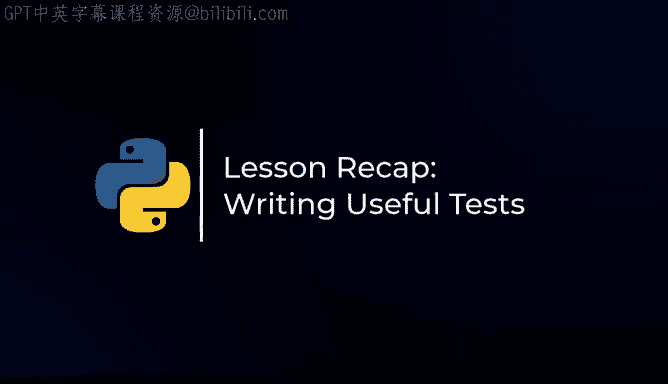

# 杜克大学《MLOps ｜ 机器学习运维（Python基础）｜MLOps ｜ Machine Learning Operations》 - P47：47_03_07_课程回顾-编写实用测试.zh_en - GPT中英字幕课程资源 - BV1kw4m167aV

。

So now you know when to use classes versus functions and use advanced features of P test like parametries and even you now are fairly confident with using plain asserts which allow you to have that very rich and thorough reporting when a failure happens。

 these are all very crucial things to know about P test and testing in general because now you're able to write test and look at a failure and be able to identify exactly where the problem is so you can go fix and make sure that what you're fixing will actually fix the problem and not cut in our bug。

