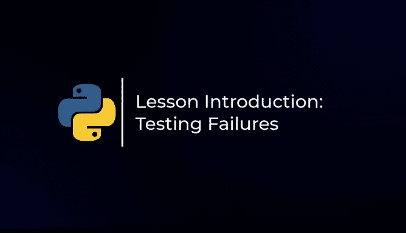

# 杜克大学《MLOps ｜ 机器学习运维（Python基础）｜MLOps ｜ Machine Learning Operations》 - P48：48_03_02_课程介绍-测试故障处理.zh_en - GPT中英字幕课程资源 - BV1kw4m167aV

。

Knowing the tool that you're working with at a better level will allow you to be more proficient when failures happen in this lesson we will cover different various things like using PDB a Python debugger。

 but as well as other things like fixtures， which allows you to even write more robust tests with the facilities of taking care of all of the underlying problems that having helpers might cost like automatic removal of files that you don't need for every single test。

 so we'll cover those and that will give you a good foundation to be more proficient by writing tests and debugging them。

