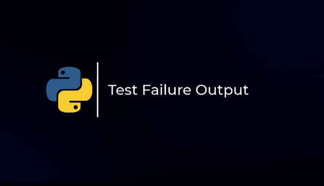
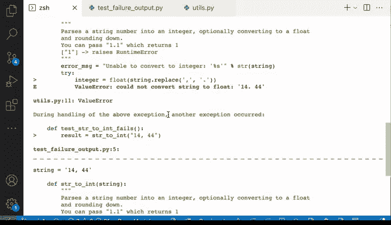

# 杜克大学《MLOps ｜ 机器学习运维（Python基础）｜MLOps ｜ Machine Learning Operations》 - P49：49_03_03_测试失败输出分析.zh_en - GPT中英字幕课程资源 - BV1kw4m167aV

。

We've already seen a little bit of Pt output and what I want to show you right now is going into detail。

 So I have half a u again a file u module in Python that has a couple of functions here。

 a couple of utilities and I'm going to test the failure output from string to in so if I go back to u string to in this one right here is the first utilities。

 so it's just a regular function。 I'm going to pass some strings。

 I'm going to inspect some things to fail and then take a look at those so these are three test functions and some of those will have problems So if I go to my terminal and specifically ask for test failure output I'm going to say py test test failure output and run these I'm going to have one fail to past and let's take a look very quickly what is going on here so we've already seen that it tells you the path of where this is going that how many items were collected。

When you ran。And what version of Pyth test and Python you're using in this case I'm using Python 39。

 and then it tells you that in this specific Python test Python file you had an F do dot meaning like one failure and two passing and everything was completed at 100% and then it goes into the failure in the failure output one of the crucial things here is that it gives you a representation of the code under test in this case is's a string to int and here you can see that。

it is requesting it is requiring a string argument。

 but it gives you the actual representation of what the value was for the failure of the test。

 that's incredible because I can tell you how many times I've actually wanted to take a look at what the value was that was' causing the failure so here you can see oh all right so it is 14 comma space 44 ands that's problematic。

 so it gets then it tells you exactly at the line that it stops with it with that special character over here it tells you it fails right there and error is value can convert string to flow this is completely invalid like it bumps out now。

The error doesn't happen in test It happens in this other file called ut sub pi。

 which is what I show you in the beginning at line 11 and the exception is called value error and you can see here and this is Python handling during handling of the above exception another exception occurred because that I'm catching or not me but like the function is catching that and bracing something else and that end up ends up the whole thing ends up failing right here in the result of test string doing fails in this test which is test failure output line number5 so if I had no idea I would go to test failure output line number5 I'm going here1。

2，3，45 it fails right here。That's the one even if I didn't have the ability to tell what's going on with this value that I would be able to tell that it's line 5 and it's also covering u tza pis if I scroll to utza pi line 11 So if I go to utsza pi and look at line 11 it's right here it's integer float stream replace so those are my problem areas and that is exactly where I need to be so going back here you can see that the same thing happens again and at the end it raises the runtime error remember it was catching and handling and doing something else that is because it catches both type error and barrier and then reras this other helpful helpful error saying a unable'm to convert to integer because it's trying to convert to integers and at the very end it gives you a short summary info and wise is doing that because imagine multiply the failures here by 1000 let's imagine you have 2000。

Tests and 1000 are failing。 You're going to probably want to look at the short test summary to see how are you dealing with a test output that is failing。

 but these things are very useful and you can use them to try and pinpoint exactly where things are going wrong Now I'm going to increase the verbosity here you can increase it like two or three times and sometimes you get a little more context and sometimes things are emitted here you can see also that the passing the passing tests are getting included not only the fail ones but you also know exactly where they're coming from so all of these are coming from a test underscore failure output that test string to in is the name the name of the test and then if it's failing or passing。

 So those are a couple of things that from the failure output that are useful to know so that you can work around with failures in tests。

