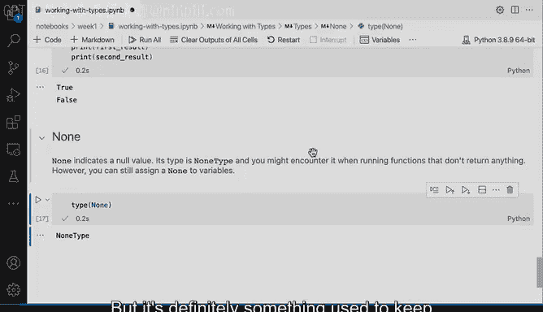

# 杜克大学《MLOps ｜ 机器学习运维（Python基础）｜MLOps ｜ Machine Learning Operations》 - P4：04_01_04_处理不同数据类型.zh_en - GPT中英字幕课程资源 - BV1kw4m167aV

。

Let's take a closer look at some of the most common types that you will be working with。

 so let's start with strings， so strings are very powerful but sometimes they can be a little bit confusing in Python so here we have a cell that is using single quotes and sometimes you will see variables strings which strings is basically a text you need to think about a text value so string is a very just common type and you will see it everywhere。

 but here I'm using single quotes So what's the difference and why why sometimes you may want to have double quotes or even triple quotes So the thing is here is that you will want to use triple quotes when to avoid escaping what is escaping Well if you have a string like this one where has a single quote and double quote here within a string then you don't need to escape it you don't need to。

Worry about that。 Otherwise you would break the string。

 So you use triple quotes to kind of like think about it as protection for the string that you're using within。

 So we'm gonna to hit execute here and you can see that the triple quotes are useful when you have a single quote or double quote within a string。

 So these are coming off correctly Otherwise you would get into trouble and probably will get a syntax error from Python Python would complain about an invalidbal syntax because the parsing would break Similarlyly。

 you can use single quotes when there's a double double quote within the string which is not that uncommon really。

 so thats that's a quick way of working with that and you can use double quotes when you have a single quote in your string。

 So you can see here how how Python has correctly put some output there that is telling you exactly what you need to do Similarlyly。

 the string support。Adding to other strings to compose text that is definitely a thing that you can do。

 You can compose new strings from existing strings。

 so I hear I'm assigning alfredo to the name variable and then I am creating a new variable called result which that an addition。

 Now this might be surprising like how do you add two pieces of text to strings well Python handles all of that and figures out the name is a string and that's perfect and then you can add it to these string with double quotes here and let's run this and see the result So the result is again an output that is composed out of two two strings so you can definitely compose text Now one thing that we saw in a different lesson is that we were using or I was using f strings and F strings is none other than using a string with with。

That is prefixed with this F character and that allows us to use variables within the strings。

 it's a way of replacing values within a string。 So if I run these it will use the name。

 the value of the name variable。 you can see that was set here in the previous cell and that's being used to create to create these string output now because it's a F string。

 the only thing it does is allows it allows us to use variables within。

 but the end result is still a string。Allright， so next up are integers and the way you can check for different types which I didn't copy before is by using the builtin type function so you do type and then open parentheses and then a value or a variable and you will see the representation of the type in this case 15 it's an integer and in Python that's known as an int integer support mathematical operations so you can run these and get some output but notice that it's no longer7 right but you can also do mathematical operations if you're not careful so if I run these you will get a zero division error。

Alright， that's not good。 but you have to watch out for things that might not correctly work。

 And you can also get into trouble。When you're trying to add other types that are noncompatible in this case。

 I'm trying to add an integer with a string， so I'm going to click execute the cell。

 I'm going to get a type error， that's a nasty error。

 so you have to be careful what you're mixing with quad in this case integers do not mix with strings in this way。

Now types can change depending on operations and we saw a little bit of that in the previous cell I'm here I'm dividing three in two parts and I'm getting a 1。

5 and I'm asking for the type of the result and the result is a float so this is no longer an integer Now I was using an integer here so that's a whole number divided by 2 and that's 1。

5 and 1。5 is a float it's no longer an integer is no longer a whole number all right continuing with a different types that we are going to work with floats is a different one we've already seen a little bit of that 14。

3 will be a float because it has a decimal point and you definitely have floats that can be a little bigger now this is a common representation of the pi number is' now very well represented but you get the idea we get some decimals and this becomes a float next up we're gonna have some booles and the boolean。

are either true or false however， you have to be careful because some data types will be represented as true or false values we'll see that later on in another lesson but for now boo is the representation for the type of true and false the bulloleans in python and that's the way you write them is with a capitalized t and capitalized f or true and false respectively All right so some of these values like I mentioned can be treated like a true or false boo can also be called and you can see here that we can pass values and boo will interpret the values as true or false bo of1 would be a true value and boo of0 will be a false value one is treated as true and0 as false so if I run these you can see that the first result was one and then two for the second result and I'm printing both the first result and then the second result。

And I'm getting a true and a false。And finally we get a non nu is very common in Python。

 some function， some code can return anon or if it doesn't return anything。

 it will always return anon that might be surprising and theres a lot of operations that you may find these non none is a no value。

 it's nothing it's empty there's different ways of defining empty in Python and none is one of them you can assign it to variables。

 you can use it to return some values or a signal that there's nothing going on。

 but it's definitely something used to keep in mind when working with different Python types。

