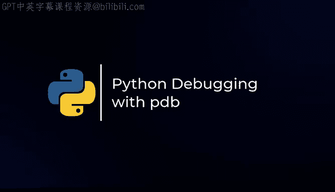
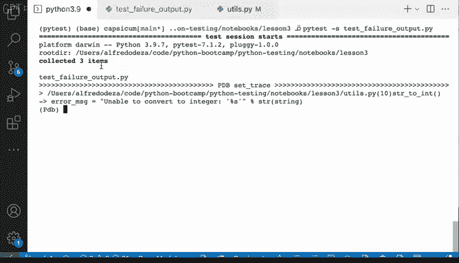

# 杜克大学《MLOps ｜ 机器学习运维（Python基础）｜MLOps ｜ Machine Learning Operations》 - P50：50_03_04_使用pdb进行Python调试.zh_en - GPT中英字幕课程资源 - BV1kw4m167aV

。

We're going work again with our test underscore score failure output file and we're going to work with this file again and we're going to run the test。

 go and look at the failure and we want to debug what's going on here So one of the things that you can do is use PV also that is short for Python debugger the Python debugger allows you to dynamically get inside the code and see what's happening inside that code there's a couple of ways that you can do this besides the whatever editor you're using in this case I'm using vS code VS code has has some facilities to debug filling test and filling code but if you're using P test。

 you can also set a debugger now the debugger can be said by using a special flag and I'm going to show you what that special flag is So instead of running p test we know it's some test failure output but instead of and in that explicitly I can say p test dash dash PB。

Which will allow me to stop the first failure and drop me to an interactive terminal with the Python debugger。

 I'm going to run that。And then it ran and at the first failure it says right here entering PDB。

 which is the Python debugger， so you can see here that it's racing runtime error。

 so there's a couple of things that you may want to。I think H is for help。 There you go。

 documented command。 you have all of these commands at your disposal。

 I usually like to do L to list where I'm at and you can see here that I'm right where the runtime error happens so I have access to all of these variables really so you can see let's see if integer is there now if I go back to us let's see what I have access to them I'm gonna look and my function here and I have string so if I go here and say string you can see oh string is 14 comma044 all right so what happens and L can give me better context if I pass the line number and this is Python debugger works anywhere is just a Pyth is giving you a better ability if I say L 10 it gives me better context on line 10。

So I can see here that is' trying to do the string replacement Integer fails and it doesn't it doesn't really。

 really work right because if I do integer， it's not defined so it doesn't even it doesn't even get to integer because it fails it tries to set that again it also fails and does the runtime runtime error。

 Now we want to know what that float string replace operation might happen。

 let me see if I can do float and then string， which is the input。 let's debug this oh there you go。

 value can string to float So now I have an idea what might be the problem here because it's trying to convert the string to a float then I will have to figure out a robust a robust way on trying to convert these I think that even if I did in this could be a problem with the same same thing with。

And so perhaps one way will be to get rid of that comma since it's getting rounded down and it doesn't matter and take the first spot that could possibly be we one solution。

 let me see let's try it out so solution equals string that split on the comma and then let's take the first item so solution would be 14 and 14 would work both with float。

If I do this and it would work with int as well so there you go。

 I mean I can have an idea of where I want to be and if I want to go next I do n or or I can do C for continue and that said now what would happen if I want to be exactly exactly where where this failure is I'm going to go to us I could say say I want to be here I could say import pV and then PDV dot set underscore traces and that will put me there Now the problem with this in particular is that is' going to do this for is going to stop here for single every single test and I have three tests and iss going to do the same thing I'm going remove now my PDV flag I'm going to use dashes because I don't want to I want to tell P test a by the way I'm not going I'm going to run interactively and it collected three items and this is not the the first test。

The one that fails， the second one doesn't， the third one doesn't。

 but you saw that he put me there on the three chances so now if I do L you can see that he's right here on line 9 and now it's putting me on line text the very next lines if I do string string is 14 comma 044 so there you have it those are three or two ways where you can use PDB for debugging ands spunking on what the variables are and you can either stop on the test itself or stop on the code under test。

