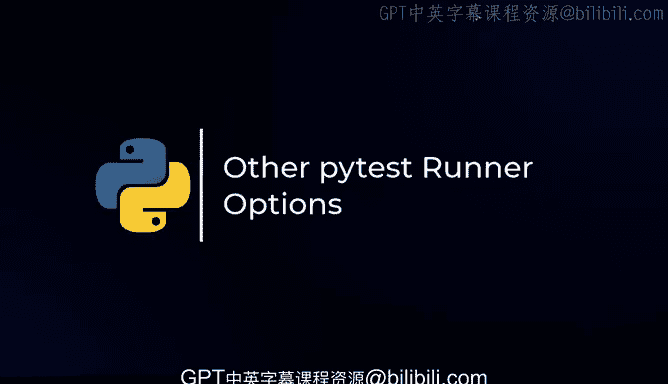
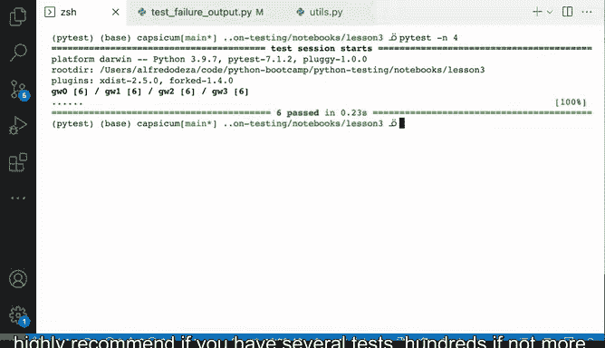

# 杜克大学《MLOps ｜ 机器学习运维（Python基础）｜MLOps ｜ Machine Learning Operations》 - P51：51_03_05_其他pytest运行器选项.zh_en - GPT中英字幕课程资源 - BV1kw4m167aV

。

There are a few other Pt command line tool flags that are worth going over。

 you can go and take a look I mean besides the documentation going over the help menu。

 so always a good idea and you can see here there's a lot of different options and I'm going I know I'm scrolling super fast and it's going to be very difficult to try and catch everything but I highly suggest you go through some of these and see if if you are able to catch anything that is interesting。

 I usually use this collect collect only to see if I'm having problems with my test collection。

 it will only display the tests that are collected and won't execute anything so if I do for example Pi test collect only you can see here that it collected test failure output and have an RF file here with test called test score features which I'm going to cover next it has other things in there as well Now that's really good。

again， we have several files， we have six tests if I run them all if I say pi test you can see the one failed and five passed what if I have a very large test suite with several tests and I want to stop at the first failure well that's where dash x comes in so if I do pi test and I cleared is dash x then you can see that it stopped after one failure so one failed nothing else ran so my output then becomes really concentrated on or limited just to wherever that failure first happened and in this case I was lucky enough that the failure happened in the first step or the first test and nothing else ran so that's really good so dash x is definitely definitely one of the things that you want to you want to catch and。

So now and then the other thing I want to cover here is and I really like this Pyte is really feature and it has the ability to install plugins and there's this plugin in particular。

 if you have many， many， many tests that you can run in a distributed fashion so I'm going install that Pip install Pte dash and clear these p test dash xd a plug and I already installed it previously that's why this thing when very fast and what that gives you is the ability to pass these flag dash in and I want to say for and what that is going to do is going to set four different test runner instances and run them at the same time Now it's not very clear because I have a failure here but you can see here it created a gateway gateway with some test and it's executing the test in parallel。

Now let me quickly fix these tests so that you can see how it looks I'm going to do clear this thing again。

 run this again and I mean I only have six tests but you can understand that if you have hundreds of tests and you're executing them all in parallel well these would go much。

 much faster so there you go those are a few of the flags that you might want to use for Pythtes especially on the command line and way to install a useful plugin that I highly recommend if you have several several tests hundreds if not more。

