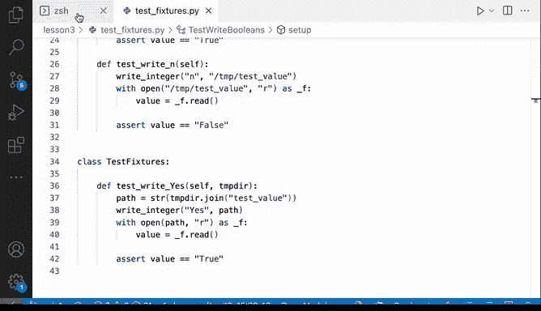

# 杜克大学《MLOps ｜ 机器学习运维（Python基础）｜MLOps ｜ Machine Learning Operations》 - P52：52_03_06_pytest夹具.zh_en - GPT中英字幕课程资源 - BV1kw4m167aV

。

Lastly， one of the things that I want to touch on is Py test fixtures。

 I'm gonna to show you one when Pyte comes with a lot of test fixtures。

 now I've avoided them for the longest time and I came up with my own workarounds to do with fixtures but I highly recommend them once you try them out you will see how really nice they are so what's the idea with fixtures fixtures are think about them as plugins from Py test and the only way or the only the only thing you need to know to get to use them is to require them as an argument。

 so let's take a look at these test underscore score fixtures of pifi with a Python module and I have these little function here that writes an integer as you've seen before we have the string to function here it will convert that to a value and then it will write so it opens up a path it writes to that path and it writes。

A value that is converting from a string so that each' either a true or a false。

 And that's it that's all that this function does。 And when I test it。

 So have these class over here called test write bulloleans So I have a setup remember a setup will run every time before any single test starts in the class。

 So if if the path exist of slash temp test value， then it will remove it so that all test can do that on their own。

 So test right Yes will write an integer like will run the function and then it will open the test value path and read from that and make sure that that is that the value coming from there is true and then it will write an n and that should give you a false。

 So there you got there you got there you have it you have two files one is going to write a true There one is going to write a。

It's going to remove the thing。 So where do fixtures come in and this is perfectly fine。

 except for one one important thing。 The structure is fine。

 but the underlying code is not that robust I'm here I'm relying on st this is not very safe if I had several tests running at the same time imagine like I was using Ptest ex like I did before I showed before with multiple runners running in parallel and all of them accessing this file I might get into failures that I can't really control So this is not very well a good very good solution here would get into trouble pretty fast andlasht doesn't exist in every single system you might be running this on a Windows box andt wouldn't work there and sometimes I think even on Apple computers even window it exists sometimes might named something else So what do we do we're gonna to use fixtures and we're gonna to use a。

We're going to use a class， but this could very well be a function， so all you need to do。

Is write your test method here always with a self the method and then I'm going use this thing called Tder。

 I'm going require Tder Now I'm not importing anything I'm just requiring that argument Piyte is going to execute that method it's going to figure out this test wants the Tder fixture that I have is a built in it has its own documentation how to use it I know how to use it and on line 37。

 I'm going to say the path is going to be I'm going I want this test value file so I'm going to say Tder that joint test value all that line 37 does is it gives you an absolute path to where you want to write and then I'm going say I'm going to use that on right integer。

 I' going to say I want to write yes and I'm going to use the path from the tempder fixture and just like before I'm going to read that I'm going assert that the value is true so it is essentially the same type of test。

'm going to say， I'm going to print。 so you can see not， not that one。

 but so you can see what the path is。 So I'm going to print。The path from T fixture is。

And I'm going to say that's the path。 And I'm going to fail this on purpose so that you can see。

So you can see how this is reported by P test， we going say P test。

And I'm going to run that and you can see here that the path from the tender thats I mean it's hard to see the path from tender fixture is s private s var folders。

 where is this coming from look look at that look at this name here and then p test of Alfredodesa P test 13 test right0 test value so pte makes a very good conscious effort to try to make that super unique with the capacity of avoiding collisions and conflicts and then not only that it then takes care of removing it for me so if I rerun these test several different times if I go back here and I run these several different times again then that's going to be fine is' going to be there's no way that I'm going to cause any issues so unlike here where I was requiring this setup and making sure that that's removed I don't need to take care of that。

One powerful fixture Pythus has many different fixtures。

 If you check the documentation for Pythas fixtures。

 you might find things that even allow you to set environment variables。

 create files and do all kinds of different things including capturing standard out and standard the error or even logging sos there's a lot of things that you can use。

 but you can see here in this case this is very， very robust。

 very good code helper code to write robust tests。

