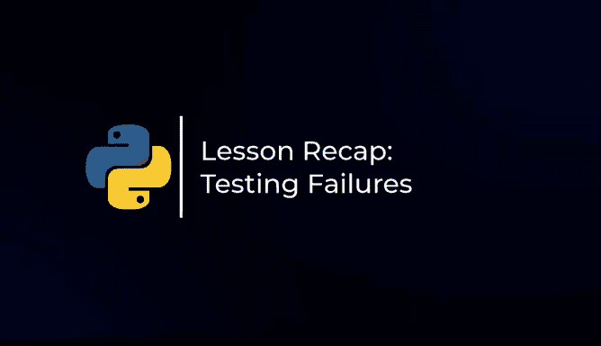

# 杜克大学《MLOps ｜ 机器学习运维（Python基础）｜MLOps ｜ Machine Learning Operations》 - P53：53_03_07_课程回顾-测试故障处理.zh_en - GPT中英字幕课程资源 - BV1kw4m167aV

。

Debugging tests might get tricky， but we were able to see how PDV helped us out as well as using some of the other more advanced flags that you can use with by test in the terminal。

 all of these will help you be more proficient at the time to fixing tests that might be failing and exploring why some values might not be getting a test passing。

 so you're ready now to be working with more complex tests and hopefully you're good to go with writing more tests that might be useful。

