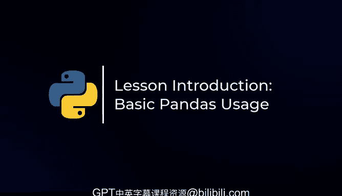

# 杜克大学《MLOps ｜ 机器学习运维（Python基础）｜MLOps ｜ Machine Learning Operations》 - P54：54_04_02_课程介绍-pandas基础使用.zh_en - GPT中英字幕课程资源 - BV1kw4m167aV

。

In this lesson we will see a little bit about pandas and we'll get introduced to pandas how to load data。

 visualize a little bit of the data that you're working with。

 and look at some of the many different methods to export for writing data。

 but also for loading data， we'll see why pans is so flexible and why that is helpful。

