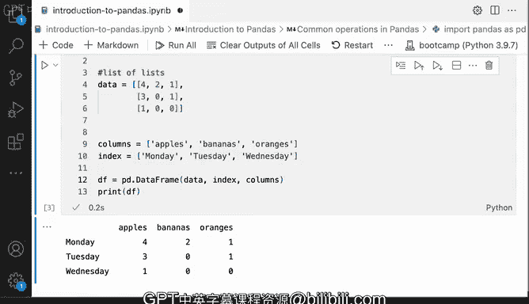

# 杜克大学《MLOps ｜ 机器学习运维（Python基础）｜MLOps ｜ Machine Learning Operations》 - P55：55_04_03_pandas简介.zh_en - GPT中英字幕课程资源 - BV1kw4m167aV

。

Pas is a Python library to added low visualized clean manipulate data sets and data in general。

 it is very powerful， it very common it has all kinds of different helpers and utilities to work with it Now pandas doesn't come with Python so you will have to install it in as always and how I always recommend these you will do Python 3m VM VM really you can name these whatever VM the first VM is the Python module So Python 3 z executable dash M indicates I need a module I'm going to use the VM module and VM is the name of the directory that I want to use you can use anything that you may want and then you going to activate that and then you can install pandas。

 the package to install is name pandas and that's how you would install it now as always make sure that you have a requirements that text or something similar that declares your dependencies for。

y project so that when you come back， you know exactly what to install or what versions and I've included a link here if you want to follow the documentation。

 if you want to install it on different systems or if you're having any trouble now for this case and I'm gonna I make sure that have a python special Python installed here that I've selected for this Jupyter notebook you can see here it's called bootcamp is Python39 and I've already installed pandas but you can see that's why it comes a requirement already satisfied it's already good in my system so I don't need to reinstall it again but if you're running this for the first time make sure that this is activated the right kernel is selected and you can go ahead and install it this is all coming from a virtual environment you can see here it is right there virtual ems is being shown allright so。

You've installed pandas， you're good to go， you have a Jupyter notebook running with the right kernel and the right dependencies so normally in pandas what you will see is line1 import pandas as P that is very common that this is known as an import Elilias you're importing something but you're making it available as something else as a different name。

 not something else but a different name in this case it is very common to see pretty much every tutorial including the pandas official documentation use Pd and Peter delta right there。

 so import pandas as P fairly common you've installed it。

 you want to try it out and the way to think about this is that you're going to use pandas like I don't want to overcomplicate these but is usually referred to as potentially multidimenion。

Aray and effectively that means almost like thinking about this an as a spreadsheet where you're holding values。

 you have columns， you have rows and you have sales or fields in those one。

 So these data variable here that is a list of lists one list with one to three lists in it with different numbers doesn't really look very nice but we'll see what pandas does about that and I'm going name my columns I'm going say apples。

 bananas， oranges and my index is going to be Monday Tuesday and Wednesday so let's just pretend that I have these fruits that I have how many fruits I had on each day and from Monday to Wednesday so I'm going run these and then I'm going create these data frame sorry I'm going create these data frame on line 12 and I'm gonna print what that looks like。

Allright， so what is going on here Well I've created my data frame。

 That's the main object you're going be working with in pandas and panda has other options for different types of manipulating data including a series but we're going to concentrate mostly on data frame with pandas on these examples。

 What I did was with some data and columns and an index。

 I was able to create these representation almost like a spreadsheet representation of these things I managed to correlate data in a meaningful representation way of what I want to do So its hard that's what pandas does it loads data。

 it lets you look at it in a specific way and then of course man that data fix it change it adapted and even do some plotting as well so thats。

What you need to know to get started with pandas and we'll be looking into more detail as some of the other excellent features of this amazing library。

