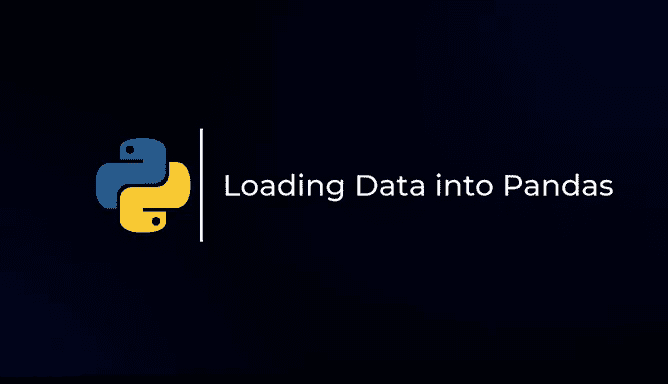
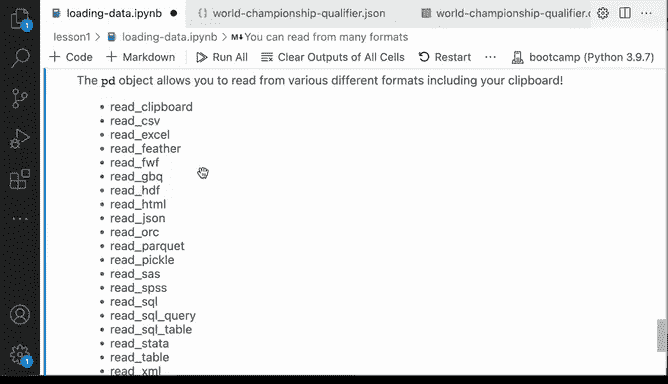

# 杜克大学《MLOps ｜ 机器学习运维（Python基础）｜MLOps ｜ Machine Learning Operations》 - P56：56_04_04_将数据加载到pandas.zh_en - GPT中英字幕课程资源 - BV1kw4m167aV

。

Pas is very flexible and I'll be repeating that all over this course I'm really surprised by the amount of flexibility that the people behind pandas have put into these amazing library now I'm going to be talking about how to load data into pandas but there's more than one way and this is great because your data sources might be coming from different places so there are different ways to load data into pandas for sure in this notebook I'll show you a few different ways。

 now we are going to be working with data frames primarily and with primarily one data。

 Now these data it's in a Github repository it's somewhere else it's out on Github So how would I bring it So you might find yourself in a situation like this one and in this case this is a repository and the data that I want to be working with is this comma separated value fire。

Here called Wine ratings from two years ago， it's 12。

9 megabytes I can't well GiHub doesn't like it when I want to show it like this because it's a lot of a lot of data but how do I do this。

 how do I get access to this well if you click here and copy these URL to view it raw then you will get access to the full URL you can use this URL as it is because this comes with HTMLs but if I click here you see I'll take a second you'll see that there's a lot of output and what you need in that case is capture the URL？

And the URL for this one will allow me to load basically。

 so load that data onto the pandas data frame so that this is the URL right here。

You can see its wine ratings CSB。 And do you see how the URL changed from my Github repository to this Github user content that just make sure that whatever URL you're using out there。

 these will get you the actual CSB found that HTML。

 So that's one gotcha that you need to be aware of。

 So it was able to read that and you can see here that I'm loading these as a data frame。

 Now data frames are commonly just abbreviated as Df。

 but you can make that something more meaningful。 this could could have been a variable named wine ratings。

 I'm just using Df and then Pv for pandas that read CSB and I'm passing the URL and I'm saying hey。

 by the way the columns the index column0 that test the index because you already had an index and Df had to show me the first 10 items So there you go I've managed to load that and this is how my data works。

 So it was able to。That CSB from a remote URL and a Github repository it has loaded and it has a representation here you can see that the headers are for the name of the columns。

 the headers of that CSB file are all very well represented and there now you might be working with a local CSB file and you can absolutely 100% load that if I show you the file system and this world championship qualifier that CSB file is also there so if I click here you can see that that world championship qualifier is here so you can see that's my limited very small data set I'm going to be working with and you might be wanting to load that and if I run these it definitely works as well and you can see rank name nationality result notes and group is also right there there's a 33 results and it's loading them and after loading。

Notice that I'm just using read CSsB as well， but these might be a different type of data data file as well。

 and you can use other loading techniques， and I'm printing the Df that data frame you're able to do that or just use a Df head as I was doing before。

 so I'm gonna scroll down I'm gonna show you how to load Jason from a local file。

 which you can also do if I go here。And show you this Json file。

 it is the same thing but in a different format in this case is Jason now I'm going to go back to my Jupyter notebook and you can still read that。

 but it's no longer read underscore CSB is now read underscore Jason if I run these it looks exactly like the representation is the same because behind the scenes pandas is composedosing these。

The data in a way that you can represent it with a standard standard view of columns and rows and data fields All right。

 but you can read that from many different formats including the clip or which I think it's excellent and you definitely can read from Excel like if you have an Excel spreadsheet and you say that pandas can definitely 100% load from an Excel spreadsheet and work with it and you have all kinds of different things that you can do even Xm and HTML it is fairly fairly powerful So there you go。

 you have several different ways on how to load data into pandas including one very nifty way by just passing a URL from a remote Gith repository。

