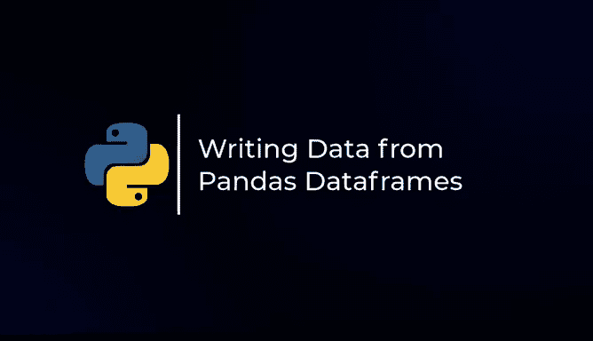
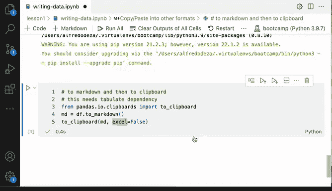

# 杜克大学《MLOps ｜ 机器学习运维（Python基础）｜MLOps ｜ Machine Learning Operations》 - P57：57_04_05_从pandas数据框写入数据.zh_en - GPT中英字幕课程资源 - BV1kw4m167aV

。

When we're loading data into panndas， we're doing it from the pandas library itself from PD when we're writing data from pandas。

 we're doing it so from a data frame so here we're going to start with the data frame we're going to use these CSB found that is local which is the world championship qualifier that CSB which is just results from and qualify around World track and field Championships back in 1996 and I'm going to import pandas PD as always I'm going to create my data frame in line2 and I'm going to get a representation of my data with DF and you can see here the results perfect we have some problems here with the data set that will have to fix data but effectively this is our data frame we've loaded our data set our data as a data frame object and now we can do some operations there。

 but you might be wondering like well okay so how do I write to other destinations to other files well。

You can similarly as loading， you can write that to different destinations to the clipboard to CSB to Python dictionary to to Excel。

 you can create an Excel spreadsheet from that data and you can do all kinds of different even parquet which is quite powerful way if I storing a big datas aside from from Python so all of those options are available to you now one that I wanted to show you was how to run it as to HTML and how that looks like so I'm going to run these I'm going say Df to HTML and it's going to show right here in my files I'll show you in a second so I run these data HTML is written so you can see here that now this is up and running so you can see here that it basically created the data it created these table this HTML table。

With with a head and a body and rows and data all over the place。

 if I open my browser this would load perfectly fine locally。 So if you're dealing with HTML。

 you want to transform your data from one place to the other then to HTML would definitely works。

 So let me close again close my data HTML is's just a way I want to show you that you have one of the many different ways to export that data Now you can copy pasting to other formats and I want to show you one way where you can do this with markdown now you might get an error sayingna that there's a dependency in it here called tabulate So I'm making sure that I've installed that that dependencies So I'm not going have that problem and I'm I'm going create I'm going import from pandas that IO clipboards import to clipboard that basically means the object is going to get pasteed on my clipboard on my system clipboard。

So I'm going to。Tell the data frame that it needs to get exported to markdowns so I'm going to say markdown here and then I'm gonna call two clipboard I'm going to say markdown and Excel false so that it doesn't think that I'm pasting on an Excel spreadsheet and I'm going run these and now now this data frame is on my clipboard I'm going to create a new cell so I can show you markdown here and I'm going paste these and there you go that's markdowns。

 if I click this check button you can see that markdown has being created so that's a very solid way where you can create these utilities that might be useful for you for because panda is so flexible with all of these different ways where you can export data。

