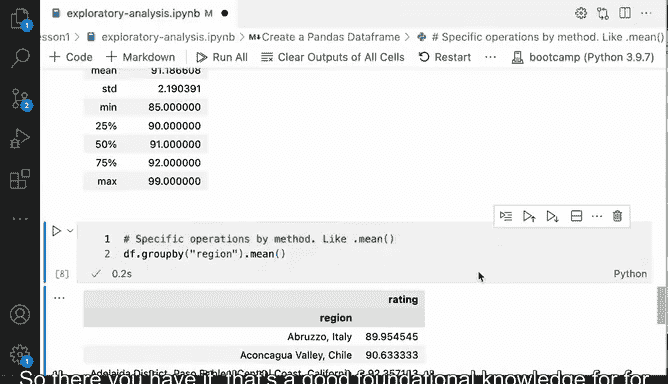

# 杜克大学《MLOps ｜ 机器学习运维（Python基础）｜MLOps ｜ Machine Learning Operations》 - P58：58_04_06_使用pandas进行探索性分析.zh_en - GPT中英字幕课程资源 - BV1kw4m167aV

。

Let's do some exploratory analysis with pandas one of the powerful things that you can do with pandas after loading is of course。

 doing some exploratory analysis like looking at data finding if there's anything useful or unusful like if there's stuff that you don't need and you're only interested in one particular association of data or a particular row or set of rows or columns then this is how you would do that al right so as always we are going to create a pandas data frame and I load the data set that I had from this GiHub repository that I show you before and I'm going to read that I'm going to say that the index is column0 because it's already that data is already indexed that I don't need to pandas to create on our index for me and the most common operation that you probably see me already do is using the dot head。

Method now you can pass in an argument， an optional argument in this case it's a number that you can say how many rows you should be looking at。

 so I'm going to look at that and I said 15 and here I'm going to get 15 items number 14 on the index because it starts at0。

 but by the fold。I don't need to pass anything and I can run this again and you can see I'm going to get just55 items。

 Okay so half name gray region variety rating notes。

 this is a wine data set so it's basically the wine name what type of grape you can see here that we have a problem here with our grape column and then what region is it and if it's a red wine or white wine and rating and some of the notes the ratings in wine goes from anywhere from around 80 to 100 and 100 being like the best or perfection I would say so I'm going to scroll here and now let's get a description of the data so you're going do you gonna do Df that describes so the data frame has a describe method and here you get some useful numbers so you can see here that basically I have zero grapes So the grapes my grape column。

Has to go。 It is pretty terrible， but the rating is interesting rating is interesting because most of them have numbers and you can see that the maximum value was a 99 so I don't have any wines that are 100 in ratings that the top 75 percentile is 92 and you can see that that the mean is 91 can you can actually you can see the minimum is 85 probably not a very good wine for these wine critics that rated the wine。

 but you can get a good solid idea of what type of data you're dealing with now you can also have something similar with D you have that info that info method and when you call that you'll get a little bit more information or I would rather say different information So you have3。

2000 entries。And and you can see that the index goes from 0 to 32。

 this is important because if your indexes were messed up or you have a problem with your index as you could tell right here and we have six columns which is great and it tells you what are the types I have some flows。

 two floats and then the rests are objects and I have 1。8 megabytes in memory usage。Alright。

 so what are the things that we can do now with this information now we can also sort based on some conditions I want to sort the values by rating and I want to say a sending equals false so basically will mean the sending So if I do that and I run this you can see that it will rate by by the highest rating going down so all of these wines are top wines in the in the world and you can see here you know you have wines from France and and one from Spain and this is red wine and the rating is 99 I mean it's the top basically the best wines ever and the indexes are right here so I'm sorting the value so if you want to sort based on a particular comm that's how you would do it。

And here you can do some replacements in this case。

 if you like this is a way to do some replacements and operations on the text。

 but I'm not going to do that right now， I're going to see that later you can drop certain certain columns as well in this case we saw the grape is now very well represented。

 it's not a number basically or it's kind of like not a number NAN means like a a nil value like it's not a number is how panda represents that so I'm going drop it and when we're gonna to say is Df drop then the name of the name of the column and then access is one in place true meaning hey just don't create a new data frame just do it in place。

I'm describe this again and I'm going to have rating no longer we're going to have grape so you can also do group by operations if I want the mean for the region you can run these and you can see that the rating per region you can see Italy like the rating the mean is almost 90 there but you have other regions that are fairly fairly well positioned like Napa Valley here with 93 and Paros with the 92 so those are very prominent wine regions so you can do other exploratory regions by grouping specifically what is it that you want to what correlation you want to do so there you have it that's a good foundational knowledge for doing exploratory data with pandas。

