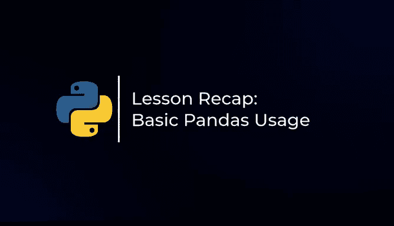

# 杜克大学《MLOps ｜ 机器学习运维（Python基础）｜MLOps ｜ Machine Learning Operations》 - P59：59_04_07_课程回顾-pandas基础使用.zh_en - GPT中英字幕课程资源 - BV1kw4m167aV

。

In this lesson we were able to cover different ways of loading data。

 we started by looking at a remote GiHub repository with a CSB format data set and we're able to retrieve that data remotely from that URL and load it and create a data frame。

 but we're also able to look at different file formats。

 different ways of loading those file formats and different ways to save them to a file system。

 in addition to doing some exploratory work that should allow you to do all kinds of different more advanced exploratory analysis and loading data from and to different locations。

