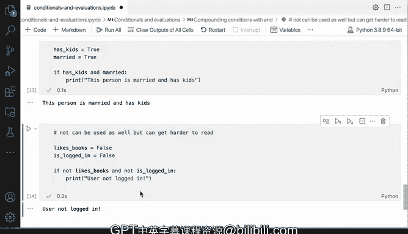

# 杜克大学《MLOps ｜ 机器学习运维（Python基础）｜MLOps ｜ Machine Learning Operations》 - P5：05_01_05_条件判断与求值.zh_en - GPT中英字幕课程资源 - BV1kw4m167aV

。

So the first thing that you want to know is the if keyword if is a keyword in Python。

 it allows us to set a certain condition and evaluate that condition and do some action depending on the result so here in the first cell you can see that the condition equals true if the condition is met。

 then it will print the condition was met so let's run this and of course that evaluates correctly so the premise here is that if condition。

 whatever that is evaluates to true then the next line。

 the next block will get executed so that's the basis of logic handling in Python conditions need to evaluate the true to be able to execute the next line。

 of course their exceptions and there's always that you can handle other types of situations where the condition is not true and we'll take a look at those in a few seconds All right so what happens if the condition is false well。

Nothing will happen because Python will see that condition here evaluates to false as defined here by the variable and so the condition the print statement will never will never execute now I covered a little bit or I mention a little bit of these before but some data structures are true that means that when they're empty the evaluate to false but true when they contain certain items here you can see that the groceries variable is empty so the code will save groceries print we have some groceries and I'm initializing here another list called invites with two items and we save invites print we have some invites so if I run these you can see here that we have some invites but we don't have any groceries now lists I'll cover in our next lesson but the important thing here is that to know that。

Certain data structures are empty， they evaluate to false。

 and I would say this is pretty much true for every single data structure in Python that is a built in data structure。

 and when it has some items， it will evaluate to true。

So you have to keep in mind that that's a problem or not a problem。

 but something that you need to be aware of。 Now， other data types like integers in this case，0。

 it will evaluate to to to false and and a positive integer will evaluate to true。 So if I run these。

We will get will get that there's no properties that we have properties will not execute。

 but we have parents will because parents equals2 and that values to true。All right。

 so also operators are supported and there's all kinds of different comparison operators。

 I think theres pretty much every single operation for operators are supported and if I run these you can see here that if property is E0。

 I have no properties so that got correct because properties e0 in fact so that evaluates a true and if parents is more than one。

 there is more than one parent and that evaluates correctly because the parents is the variable is equals to2。

AlRight， so next we are going to look at else conditions。If certain conditions are met。

 we can do that otherwise we can do something else。 So in this case。

 if properties we have properties， but we don't have anything that's where the else block will come into play So you can see here at the bottom we don't have any properties will be the output of the cell because that's the else condition and that's what got executed because the previous condition was false so that's like an otherwise in English the other thing is using L if condition。

 So L if conditions are useful when you want to say not only like an else So this is a very similar piece of code as before。

 so we have e properties we don't have any properties。

 So that would come to the next statement which is an L so that basically means it's like an else is like an otherwise otherwise these other situation but you want to evaluate another condition so we want to say。

If they parents there are parents then do something else。

 so we don't have any properties but we have parents so that's that's great。

 so you're evaluating also so it's like an else but with the added benefit that you can evaluate another condition。

And again， I mentioned this at the beginning， but you can also have situations where you have negative conditions。

 So here name is assign a none。 remember we saw those as variable assignments that you can do with different types if not name so you can use the not keyword so that basically reverses the evaluation to the opposite so name is none and it's treated like a false so not false would be a true that way we can say something like didn't get a name so if not name print didn't get a name means like it's evaluating correctly so you're evaluating negative conditions。

 Now the same is possible with LF conditions。 if I run these will get no name and why is that because the last name is none we're saying if not name print print name but you can see here I also have not last name but name。

Was already none so let's change that very quickly to something else。 So say for example。

 we can say alfredo' first name and we run and we are we shouldn't get oh know that's the last name。

 So if we say the name let's let's quickly change name here to Alfredo and last name。To none。

 And we run these。 we are gonna get no last name either because it didn't enter the if block and you continue to the L block next。

 Allright， so you lastly， you can compound conditions with。

 Now be careful with compounding conditions because they can get kind of hard to read。

 So here if I run these， we have hascades married， they're both true。 if hass and married。

 print this person is married and has kits。 So I'm going hit execute and correctly evaluates to true because both these conditions。

 hascades and married are both true。 And the same is the same thing you can do with not So here not like books and not is logged in and print user not logged in will evaluate to true because both these conditions are correct。

 not like books means that。False will evaluate to true and not is logged in here， which is false。

 will evaluate to true。 So that's it。 That's how you use conditionals。 And with these bases。

 you will be able to handle a lot of the foundational logic in Python。

