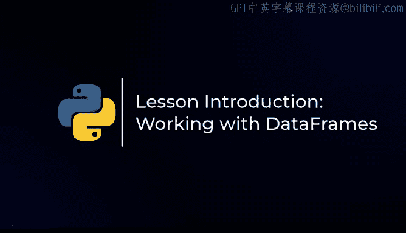

# 杜克大学《MLOps ｜ 机器学习运维（Python基础）｜MLOps ｜ Machine Learning Operations》 - P60：60_04_02_课程介绍-处理数据框.zh_en - GPT中英字幕课程资源 - BV1kw4m167aV

。

In this lesson， we will cover a little bit of more advanced things that you can do with pandas and data frames in particular。

 from manipulating text， creating new columns， and even visualizing some of the operations that you're performing on data frames。

