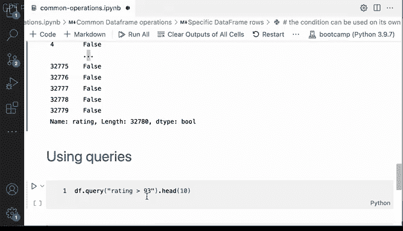

# 杜克大学《MLOps ｜ 机器学习运维（Python基础）｜MLOps ｜ Machine Learning Operations》 - P61：61_04_03_常见数据框操作.zh_en - GPT中英字幕课程资源 - BV1kw4m167aV

。

Now let's dive into some of the common data frame operations that you may be doing with pandas now as always let's start these and load our data set here with our CSV data set we're always going to be working with these one ratings data it's one that I know well and now you can also of course practice without one and get some sense of the operations that we want to do so I'm going to scroll here and first let's start with data frame columns so if you want to deal with just a specific columns in here you can see that notes is one of those columns and it has some text output of like what exactly is the description of specific type of wine so if that's what you want to be working with you're able to。

Gather， get or retrieve that specific column by just using square brackets and then the name of the column in this case notes and again you're gonna get the index so always but you're gonna get the notes for sure if that's exactly what you're looking for now you can group the columns you want to work with in this case you can do name and rating so the name of the wine and the rating so both columns I can say the rest of the columns are not interested or interesting to me and you can see here that I'm also assigning them right so I'm creating creating kind of like a subset of the data that I'm working with with the name because the data frame is is allowing me to or is producing that result in operation and I can assign it somewhere else and now you can use that can you can export it as you've seen before and you can write it to file in different file formats now。

You might want to have specific data frame rows right so in here we'm going to say we want to get the top named ratings so I'm going to say from the name ratings you remember that I assign that to these data frame that name ratings are going to be these specific data frame here。

 no longer the full data frame with all of the columns so I'm going to say if the ratings if the rating is over 96 then I want to capture those and get get me that information I'm going to run these and you can see here now that the rating for the wines that is selected are above 96 and you can see different types of indexes and like we can can actually take a look at a few more there are more than5 you can see here that you can see here that I have other types of wines perfect because there's a condition and the way you pass that condition is using。

Square brackets again now the condition can be used on its own。

 So if I do these Df and square brackets rating more than 96 in Aunddis。

 you can see that it will go through。Each of the rows it will say false false false And if it finds one that matches it will say or that condition is true like you will say this is true but it's doing that operation of 32000 entries that's why you see this3 that's here Now one thing that I really really like is using queries if you use queries use it with this method called query and you use this method from the data frame so it's Tf that query and then you open print set whatever condition you want here and then that's it and then head so in this case similar operation as before but we're going to use if the rating is higher than 93 then I I want that subset so I'm no longer capturing the specific a subset of columns but I'm doing the whole data frame and you hear that everything is above 93 you have 94。

96， 95 so that's pretty good now。

You can combine。You can combine thequeries。 So here I'm saying rating bigger 94 and the region has to be from Rira Luro Spain。

 which is a very famous wine region in the world around these。

 and you can see now that all of the wines are coming from the region that I specified So again you can you can compound queries with these m percent here so the rating is above 94。

 And that's what the m percent allows me to do here。 the region has to match these specifically。

 And just show me that the1 the 10 top items so that I can visualize what myque has done All right。

 but the last thing that I want to show you is something that I'm really excited about is let me let me select the top wines right So in this case I'm going to say anything that is above 95 that's perfect。

 But what if what if I want to do some string operations you know it's like， hey you know。

these data sets here is Rivervea Luero， that's fine。

 But what if it's underscore or it has like a weird spacing in there。

 I know Riveta and Duero could be two words that I could match on how do I find something similar So the way you do that is right here you can say here on line4 Paso rollis I'm gonna say equals top ones。

 remember top ones is anything that is above 95 array rating。 I'm gonna to say a query。

 and'm going use these special notation region which is the name of my column that STR which stands for string that contains So I'm going say if it contains Robblis then that's great that's what I want。

 and then I'm going use these NA false because I have a problem with some some items that are not a number null entry So I'm gonna to say NA falses like don't worry about those and the engine is going to be Python this is critical because I'm doing a python operation and I want pandas to。

Use Python in order to interpret datato and runs。And I forgot to get the wines here so I'm going say Paso rollless that head I'm going call that run this again and you can see now that the wines that are coming out are all from Paso Roless Now it contains roleless if I messed up and there's something else that is named rollless then that would appear here you can see that the rating is matching also everything is above 95。

 So there you go that those are some of the common operations and I would say some nifty ways of working with data frames including queries。

