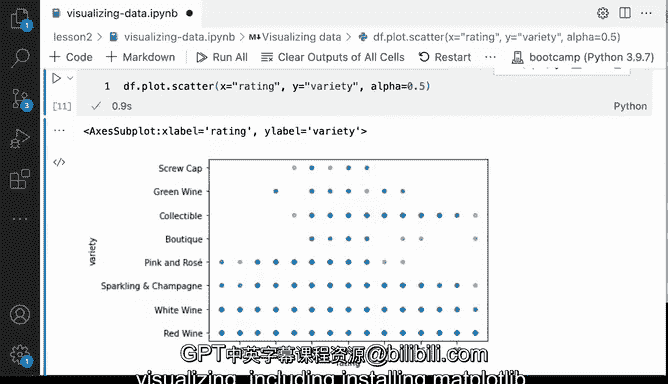

# 杜克大学《MLOps ｜ 机器学习运维（Python基础）｜MLOps ｜ Machine Learning Operations》 - P64：64_04_06_使用pandas可视化数据.zh_en - GPT中英字幕课程资源 - BV1kw4m167aV

。

Pandas gives you the ability to do some visualization and plotting Now most of the time I recommend installing MAplloot live and we'll see well take a look a quick look here how to do that。

We're going to start by loading our data frame now。

 you have to be mindful because sometimes when the data set is not quite right。

 you might get into trouble visualizing is particularly complicated with values that are have like fields that are not a number and NAN so you have to make sure that you're clean up your data now。

 you know that with this data set that we've been working with in these lessons。

 I have several several items where not a number was a value。

 so I had to drop them in this case I dropped grape， which was causing that and the。

And then in addition， I'm also doing this drop and a where anything that is not a number will get dropped so this in place drop on line5 means that I don't need to reassign the F or the data frame drop and a doesn't does require me to do that and I assign that on line number6 and then I do head and then I get a subset there you all like no no not numbers alright so the way you install mappl live if you don't have that already is by doing Pip install mat。

Pot live。 sometimes that that is required。 I have， I have this already installed in my system。

 So it shouldn't be our problem There you go requirement already satisfied Just in case you get an in error。

 Now， you know how to get it installed。 Alright， so now the。Basics of plotting。 we want to use。

I'm going to use the plot sorry like that that jump over there。

 So without doing anything I'm gonna plot directly from the data frame and you can see here that rating of the 30 30000 something once and a half you can see that some do get until up there on 98 but you get that right away very simply by straight from the data frame you can use the a methodical plot and then parentheses another thing that you can do is just select a specific column that you want in this case I have ratings and I can do that as well。

 you can see similar by default fault。Apanda selected that as plotting。

 but if you wanted something different， well you would do it with that so we could we could also have we could also try and see if some of our other columns let's take a look here at the head we had region we could we could try that or we could try variety so let' try let's try a little bit about with variety so we'm going to go here and instead of rating let's use variety。

So I'm gonna try to run that and we'll see what happens。

 So you know what happens here is that not all of your columns might be suitable for plotting so you have to you can see here that I don't have numeric data to plot so that is because panda is requiring me to have some numeric data so region fit perfectly rather the rating fit perfectly to that and I was say well to plot but you can definitely do some other things let's try these scatter now I'm going use rating and variety and we'll see if that works so that does work perfectly and you can see we have red wine white wine and we have all of these other things that had not seen before and you can see here some of them are right on the rating of 98 maybe a little bit more and the plotting the scatter plot allows me to visualize that some of those options are not quite quite there what。

A green wine well you know I'll let you decide what that is。

 but definitely some some things here are not quite right in the variety。

 but the plotting allow me to visualize exactly what was going on with this data set so there you go that's a few things that you can do with visualizing including installing MApl Lib。

