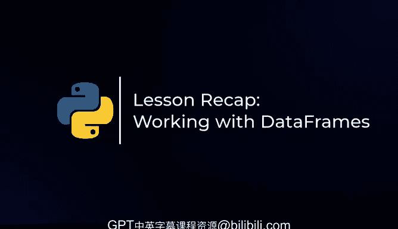

# 杜克大学《MLOps ｜ 机器学习运维（Python基础）｜MLOps ｜ Machine Learning Operations》 - P65：65_04_07_课程回顾-处理数据框.zh_en - GPT中英字幕课程资源 - BV1kw4m167aV

。

In this lesson we covered a few of the things that you can do with data frames。

 some more advanced operations like creating new columns and extracting some rows and performing some text manipulation and even replacements and finally we were able to visualize a little bit of the operations that we did so this is a solid foundation to even work more with data frames so you should be ready to do more advanced。

 even more advanced stuff with data frames in pandas in general。

