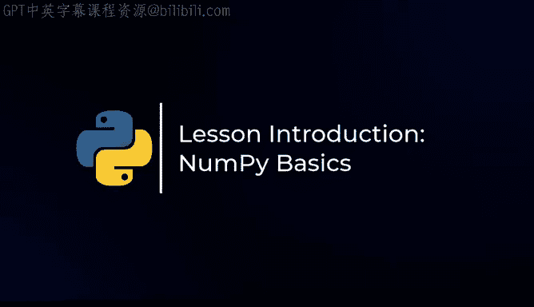

# 杜克大学《MLOps ｜ 机器学习运维（Python基础）｜MLOps ｜ Machine Learning Operations》 - P66：66_04_02_课程介绍-numpy基础.zh_en - GPT中英字幕课程资源 - BV1kw4m167aV

。

Let's see how we can work with Nmpy， NI is a numerical Python and it has a lot of capabilities to working with data in ways similar ways spandas will cover a few of the basics specifically working with a race。

