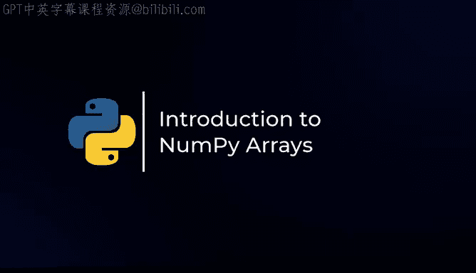
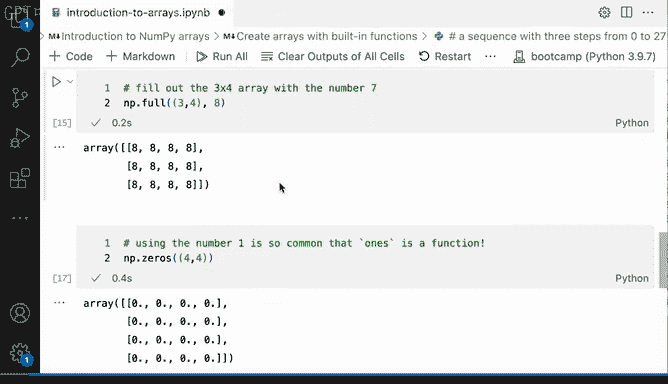

# 杜克大学《MLOps ｜ 机器学习运维（Python基础）｜MLOps ｜ Machine Learning Operations》 - P67：67_04_03_numpy数组简介.zh_en - GPT中英字幕课程资源 - BV1kw4m167aV

。

Now let's talk a little bit about Nmpy Nmpy stands for numerical Python and it is the library that actually pandas uses to do all of those fancy operations now it's much faster than dealing with regular Python data structures because it has several optimizations now we'll take a look at some of the operations that you might encounter while working with Nmpy as everything that we've done before in this course you' will have to install Nmpy and the way to install is with Pip Pip installt Nmpy Numpy is the name of the library that you will be using always used a virtual environment that is activated and ensure that that depend pen is installed in the virtual environment All right so the most common ways and this is very again similar to pandas where you import pandas as Pd Ny is usually commonly imported。

With anallias in this case， import Ny as NP and then NP is how you reference Nmpy all throughout this is just a convention and is's very common so I suggest you follow these convention as well so you can read documentation and examples with that familiarity of the import the thing with Nmpy is that it works with as and these arrays are homogenous and that is like they all have to have the same types if if you for whatever reason encounter situation where you need to have different types well you're going to get into trouble。

Nampy behind the scenes is going to to coerce that type into to fit a specific type and all of them to be the same type。

 Now， let's start by creating some arrays with a lists。 This is a brailer way of creating an array。

In Nmpy you can use a plain list so you can see here this is a Python list with five numbers there one through5 and then the representation。

 the object is no longer a list you will get a numpy array type which has its own types of properties but in most situations is very similar to using a list now this is an array with two dimensions here and the way you do that is by passing a list that has two lists embedded in them so nested nested list so here you have two lists one has one two and there one it has a two and a two so we are going to do a couple of things here first we're going to print the array that shape shape tells you what type of array you're working with in here you can see it's a two by two type of array and then when the representation when you try to see what that array looks like you will get。

The the two dimensions represented as well， so that's a nice way of dealing with those arrays。

Now you can also create a arrays with built in functions instead of passing a list here we're going to create a two by two array with random floats that will range from 0 to1。

This is a nice way of having this type of creation it's pretty handy the one thing though is that all of these numbers will be from0 to1 with coming from from RA so there you go and then we'll use also full which is a way of filling out the all of the values with a specific number so here I'm green a3 by4 with the number the number7 but the number8 actually I'm going to run these you can see it's all of8 and a half three。

Or four items in three rows four columns， so three by four array with the number8 not7 like the common says now you can also I mean once and you also have disability with zeros by the way so you can use NP0s or N1s here I'm going to create a4 by four array so there you go you create a ones full of ones。

 but you can also do a0 so you can actually say I think is zeros you can actually do that and have zeros as well another thing that I really like is the arrange method and the way it works is you pass in a sequence so you have ability to pass these arguments and a sequence from0 to4 means that it will start at0 comma then 5 and then if I run these automatically01 to3 and4。

And next you can also pass in a step value， so here I'm going to say all the way from 0 to 27。

 but every three every three numbers if I run these you get a nice nice stepped out sequence so there you have it those are some ways where you can create a array from single dimension to two and or more dimensions like we saw with with zeros and ones and full as well。

 so those are really interesting ways where you can start creating these ares with nupy。

