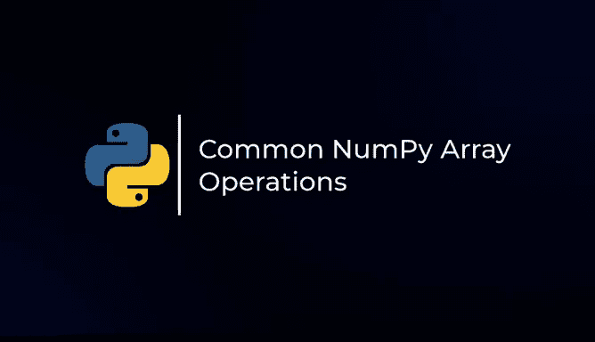
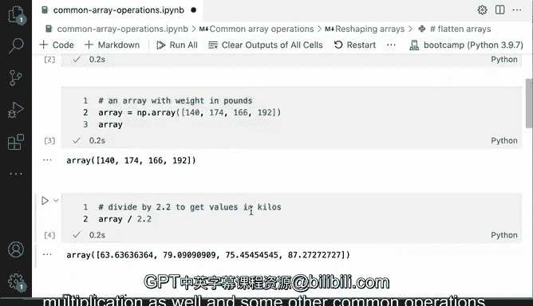

# 杜克大学《MLOps ｜ 机器学习运维（Python基础）｜MLOps ｜ Machine Learning Operations》 - P68：68_04_04_常见numpy数组操作.zh_en - GPT中英字幕课程资源 - BV1kw4m167aV

。

Now let's see some of the more common array operations that you might be exposed to and working with and always going to start here by importing Nmpy with an LS and to LS to NP import Ny as N as you will see in most tutorials and documentation so we're going to create an array here with a list when I initialize it and it's going to be 140174166 and 192 these are supposed to represent weights in pounds。

 I'm going to run these it's going to create my array perfect that's pretty straightforward now I'm going to divide I'm going to do an operation I'm going to divide by 2。

2 now you might feel like this is slightly odd because the array has several items in it。

 but behind the scenes Nmpy is going to grab these 2。

2 which represents how basically the multiplier of to convert。A kilo to a pound so every 2。

2 pounds is a kilo so behind the scenes Nmpy is going to apply this division to every single item I'm going to run these and it's allowed and you can see here now that my new array is 6379。

75 handles should represent weights in kilos you can also be faced with a reshaping arrays so for example when I create an array here of full of ones and it's a three by four it' three rows and four columns and here you can reshape that to to be slightly different。

 so here I'm going to say hey I no longer want three rows。

 I want four rows and three columns Now the one gotcha here I mean this might be obvious but it' worth stating is that these need to。

be the same number of items so if I were to say no。

 I want to reshape this in a4 by4 you would get into trouble because you can reshape an array of size 12 into the shape of4 by4 which would be a size 16 so the denominator has to be the same so334 you could do for example a 26 for sure that would be fine you could have that because the product of 2 and 6 is 12 same so you still have 12 items here and 12 items there。

 so it's something to watch out as well Now reshaping well I had the example here reshaping has to keep the same number of items so here you can also do a 12 by1 but also a1 a 1 by 12 so if I wanted to do 12 here and one there that would also be perfectly valid but again you have to keep the same number of items or。

Why you' get into trouble like here with a five and one， you can because there's not enough items。

The other thing that you can do is to flatten array， so we've had this array of you know three rows。

And four comm so we have four items here， four items there and last one and then we can also flatten them and say and that's pretty straightforward with that flatten function in Nai so those are some of the common operations that you will see when working with a race we've reshaped a little bit we've flattened them with reshaped them changed a little bit and did some math operations we saw division but you can certainly do multiplication as well and some other common operations。

