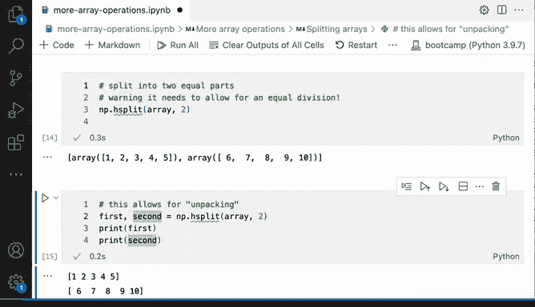

# 杜克大学《MLOps ｜ 机器学习运维（Python基础）｜MLOps ｜ Machine Learning Operations》 - P69：69_04_05_更多numpy数组操作.zh_en - GPT中英字幕课程资源 - BV1kw4m167aV

。

Now we're gonna to see some more array operations that you can do with Nmpy again Nmpy is like its primary thing is a array and we're going to be working with them adding them stacking them flatten them reshaping them and performing several operations on them now as always I'm going to start here by importing numpy as N as the elias N and now we're going to see how we're going to be able to expand expand an array so we're going to have a single dimension array so we're going to fill those with ones and going to have four items only Ire going to print that array so we can see how it looks and then we're going to get the shape we I want to see the shape I want to numpy to tell me what the shape is and then we're going to expand one row and the way you're going to do that on line number seven is by using the new axis from Nmpy。

And this helper， this little helper and I think it stands by it means a nu behind the scenes。

 Nmpi is going to look at that and say okay I'm going to expand one row and then we're to see it going to produce a new array and'm to see what the shape of that is I'm going to execute these and here you can see at the very bottom that we have our single dimension or one dimensional array and then it has four items and then you can see that the expanded shape is now one and4 so it is definitely definitely different it has expanded that with a new axis now you can also have conditional new arrays and here we have an array of these three groups and we say 312 1211。

 45 2211， 56， 15 and 22 and we want to represent all matching conditions so if I run this。

I am going to see which one will match tag condition but see the condition in line3。

 you know in regular Python that might not be how an operation works because this would work on a whole value。

 but Ny allows us to perform these condition and apply it to every single item in every single array in every single dimension。

 every single field in those arrays， so here you can see which ones are less than 20 with a true or not with a false。

Now you can produce all matching values if if what you want to have is actually get all the ones that match this less than 20 condition if I run this。

 you can see here that it produces a single single array of all of the matching values。

 so all of these are lesser than 20 coming from the array we defined in the beginning。Alright。

 continuing with other operations you might want to do some slicing so here I'm going create an array of six items starting from0 that's my array right there I could give it a range and this works similar to how it would work in in regularular lists so you have the ability of passing indexes and slicing Now the other thing that you can do which I really like is stacking stacking in nuy is the ability of putting this arrays one on top of the other in different types of ways either vertically or horizontal is so I'm going to start with the horizontal way first and。

You must have the same number of dimensions Otherwise you're gonna to get into trouble。

 So first we're going to create the first array when to print it out and then we're going to create a second array with some other numbers and we're going to print that out and then we're going to do h stack which means do a horizontal stack in so I'm going to run these you can see here that I have these twos first these like have 12 items there and the are when to have seven I have two two rows in both and now I'm going to stack them horizontally and that produces these new shape now you can also stack them vertically similarly。

 I'm going gonna create a first first array I say three by3。

3 values full and full of number ones and then full of number twos and that's the second one we to print them out and we' going to do a vertical stack。

 I'm going to run these and you can see now that it is going to vertically stack that's the v stack first and second so that's the first and then the second and is vertically it's going to vertically stack them in a single array so were this was the first the first array。

 this is the second array and now it's a stacking them in a single in a single array so pretty useful and then lastly I want to show you how to split array so I'm going to create array an array here of 11 items that's pretty straightforward and now I want to split them in two ways in two equal parts so you have to be careful because what happens here is that if I say I want to split them in in say for example。

5 because they are 11， I can do that， but if I do say7。

 it has to be allow me to do a division and I'm going to get a value error there because I can't it's going to say I can't a race split does not result in an equal division it has to be an equal division so if I say back to 2。

That should work fine。 Now another thing that this allows you is to do unpacking unpacking in Python is the assignment。

 you can see line number two you can do a first comma second equals the horizontal split of that array into two parts so will this NPH split call will produce two array so you can say I want to first in the second andm'm going to run this and now I'm going to print well this is the first array and that's the second array so those are some of the other array operations that you can do with Nmpy I mean Ny is really filled with all kinds of different helpers but hopefully with what we cover here today you should be good to go with working more in-dth with not pandas but nuy。

