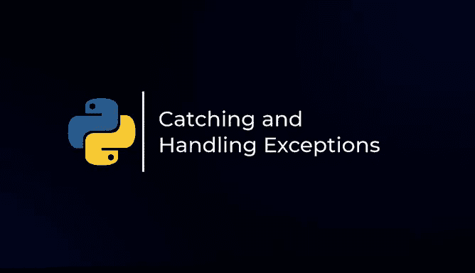
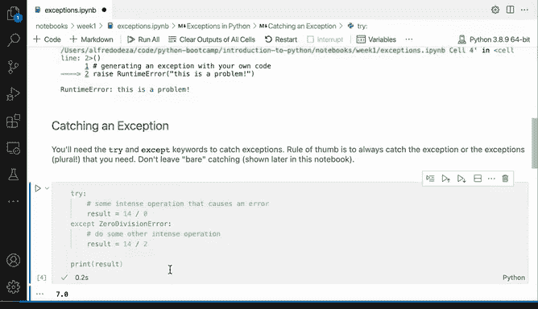
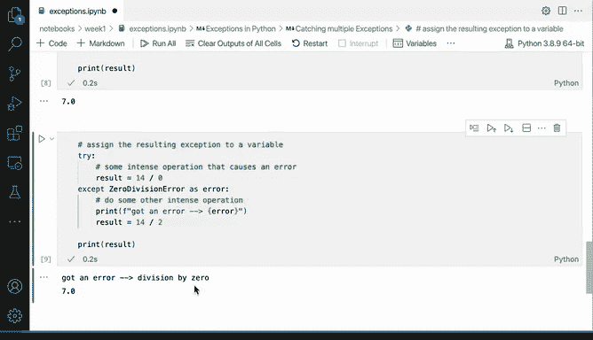

# 杜克大学《MLOps ｜ 机器学习运维（Python基础）｜MLOps ｜ Machine Learning Operations》 - P6：06_01_06_捕获与处理异常.zh_en - GPT中英字幕课程资源 - BV1kw4m167aV

。

Let's take a look at how exceptions work in Python。

Exceptions are how Python bubbles up or advertises errors in your program。

 so we've seen already one or two of the exceptions in past videos but here I'll go into a little more detail so if we run here this code which is a 14 divided by0 you will get these very nicely descriptive error which is in fact an exception called zero division error。

 so you have to be careful with the operations that you do because sometimes they might bubble up they might advertise or race or show some errors with an exception。

 sometimes the exception will have a message in this case is division by0 and zero division error is the name of the exception this is useful and we'll see later why because you can also handle these exceptions Now you can also raise exceptions on your own in this case I'm explicitly saying。

Ring a runtime error， which is a built in exception passing the parenthesesis and adding a text string here value that is saying this is a problem。

 And this correctly raises the problem and bubbles up and shows as runtime error This is a problem。

 So that is how you generate an exception so you may have a function or other piece of code and you want to interrupt and bubble up a problem and then that this is how you you would do it by using the race keyword。

 Now you can also catch an exception。 but a word of warning just catch exceptions that you're going to handle that you know that certain situations are going to be able to be handled。

 it is pretty common when you're starting with Python to try and ignore exceptions and throw them away。

 Excepts are useful。 and they're therefore a good reason In this case I'm going to run this and I'm going to get a 7。

0。 So what's going on here try。Is going to go into the next next line and iss going to do do this operation。

 which is result equals 14 divided by 0。 and that try is going to go and。

Is going to go and try to do the operation but as we've seen 14 divided by0 is going to cost a0 division error and that's what's happening here in the next9。

 I'm doing an accept so it's that try accept it's how you're going to be able to catch exceptions you're going to try something and if you're going to get into the accept block if there's an exception that matches what you're catching in this case I'm catching0 division error so I'm saying oh do some other intense operation in this case a result it's going to be 14 divided by 2 I'm going to print the result and that's going to give me a 7。

0。

Alright， so let's move along， don't get tempted to catch all exceptions here。

 you can see that I'm using an accept exception， so that's a very generic。

 very broad catching of exceptions。 That means catch every single exception that you can almost every single exception that Python has。

 It doesn't matter。 I don't care and I'm going to run these and I'm going to get a 7。0。

But the problem is that in this case we have a division by zero problem here in result and we also have a runtime error。

 so you might be getting different types of exceptions but you must know where it's coming from you must know what this thing is getting raised so I have two possible exceptions here two possible things that may cause an exception and I don't know because I'm saying exception exception So the way to lose is is to catch multiple exceptions。

 So the way to catch multiple exceptions so here I I have two things I'm dividing 14 divided by 2 and I'm catching zero division errors。

 I'm going to run these and oh no I'm also getting a type error that is because I'm using result which is a float that is trying to add to a string and you can see that represented correctly here as a type error unsported operant types for float and string。

I can't use addition to those so the way I go around that is by catching well have to go here and I have to add them as as a tuple。

 so I'm going to use a per there zero division error and I comma here and I'm going to add so you can add as many types of exceptions that you want if if I do this I'm catching both either or either either one of these zero division error or type errors if I run these perfectly works because now I'm guarding against both problems so if I went and did these two0 which would be a zero division error that would also work great so lastly you can also assign the resulting exception to a variable so here I'm going to do a try except and the result is going to be 14 divided by0 again you've seen that zero division error so the way you assign that to a variable is this statement here except exception name in this case zero division error。

As error， and then you can use that here with this print statement。

 I'm using error the variable that is here which represents the exception and I'm using an nest string to print it out。

 So let's see what that looks like。 Alright， so that prints out got an error and little arrow there and the  error was division by0 which if you remember that is the message from division by0 if I scroll all the way up here。

 that you go， that is what you're gonna get。 Allright。

 so that's how you work with exceptions in Python。

