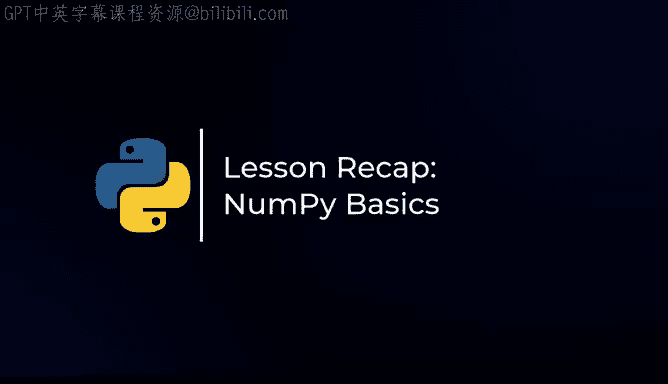

# 杜克大学《MLOps ｜ 机器学习运维（Python基础）｜MLOps ｜ Machine Learning Operations》 - P70：70_04_06_课程回顾-numpy基础.zh_en - GPT中英字幕课程资源 - BV1kw4m167aV

。

In this lesson we were able to see how to work with Nmpy from creating simple arrays to using some of the built in functions and then do some operations with those arrays including reshaping and splitting and slicing。

 you should be able now to feel a little bit confident in working with Nmpy but specifically with as。

