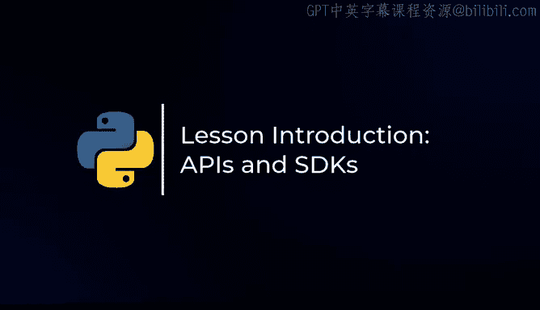

# 杜克大学《MLOps ｜ 机器学习运维（Python基础）｜MLOps ｜ Machine Learning Operations》 - P71：71_05_02_课程介绍-API与SDK.zh_en - GPT中英字幕课程资源 - BV1kw4m167aV

。

Let's see a little bit about APIs and SDKs， these are tools that you will be most likely interact when you're building automation interacting with the cloud。

 trying to put everything together and help your machine learning operations environment to produce something that is reusable and automate it and they will enhance and increase your confidence because the all of the automation。

 it will also allow you to be more proficient since youll be able to script things out and make things go faster。

 let's take a look at a few of these APIs and SDK that you might be able to interact with in your day-to-day work。

