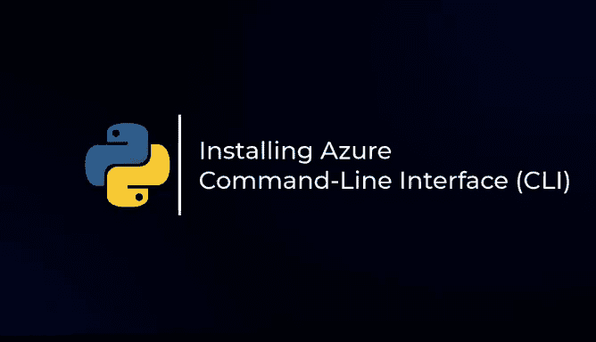
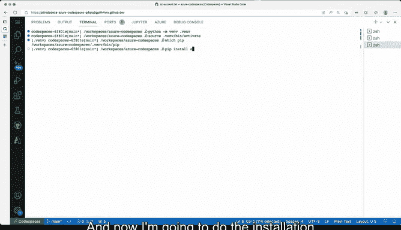

# 杜克大学《MLOps ｜ 机器学习运维（Python基础）｜MLOps ｜ Machine Learning Operations》 - P72：72_05_03_安装Azure命令行界面(CLI).zh_en - GPT中英字幕课程资源 - BV1kw4m167aV

。

Let's have a quick overview of how we can install the Azure commandline interface。

 but also the Python Azure SD the case so that we can perform some work。

 some automation as part of MLops。 one of the foundational pieces is to build automation。

 So that is why installing the Azure commandline interface and learning how to use it and how to authenticate is very valuable。

 So there's actually quite a great deal of flexibility。 you can see here。

 the installation overview has the ability to get installed on a lot of different systems that gives you flexibility if you have Cicd system like Github actions or Jenkins or code build or anything really you'll have the flexibility of going through any of these in this case like let's see how installing Azure CI Windows and then you can see that there's like even an MSi Microsoft installer with command So very flexible。

 very useful but let's take a quick look at。That looks like if I go back to here to my terminal。

 I'm going create a new terminal I'm going make it all the way up。

 I'm going make that a little bit bigger I'm going avoid showing that the AC command I do which A it's already install if I do dash dash version will show me a very useful information of course and you will tell me everything that I need to know about even in the case that here that I have an update available so another thing that we can do is install extensions So an extension is kind of like a plug if I do A extension list you'll see that there are going to be noninstalled in this case but I do want to add the M extension that would allow me to do connect to a machinery studio so I'm going to do A extension at。

and for name M。 I'm going say dash why for yes and it's going to pull that extension and is's going to make it available in the Ci。

 So right now it's going through the installation process。

 and this will take just a second to get completed。 Allright， so that completed。

 and I'm going to verify that the extension was completed。 I'm going to do Az extension list。

 And you can see now that we have an Ml extension。 What does that do。

 I'm going to do Azml dash dash help and that is going to produce a lot of Apple is going to allow me to work with online endpoints。

 scheduler， a workspace， do batch deployment。 endpoints basically manage almost everything and anything that is available on Azure machine learning studio。

Now， another thing that you can do is authenticate。

 So an interactive authentication will happen with A logging。 if I run these。

 it will get interactive。 it would bring up my browser， but I wanted to show you how that looks。

 and I have here a couple of example of outputs I am going to do AC logging， which is this one。

So the reason I'm showing it like text and not interactively is because you have the output that it comes similar to these all of the accounts that you have will be output in Jason and you can see here they have like that tenant。

 the cloud name the name the tenant ID all of it is very useful but it is sensible information Now I've gone ahead and change some of these values because again this is sensitive information so you have to be careful what you're sharing when you're doing an A login similarly when you want to list the account。

 you can use Az account and you can see here the command is A account list dash old table so that we can have this very nice representation of the output so we have name cloud name subscription ID so very similar and you can see here that the one that is enabled by default is this one that I've called demos over here All right perfect so。

What's next Well next we're going to actually install the Azure Python SDK4 machine learning。

 which is the Azure ML core library， so I'm going to open a terminal and before anything I'm going to create a virtual environment so I'm going to do Python dashM with a VM and I'm going to do a dot VM and that's going to create this dot VM a hidden directory there。

So it's going to promise yes， I want to activate that。 That sounds okay。

 but I'm going make sure that I've activate， so I'm going to use VM being activated and now I'm going to verify that Pip is coming from theversion environment It is perfect。

 and now I'm going to do the installation of Pip install Azure M dash core that is going to install all of the dependencies and libraries is needed so that I can have a parity from anything on Azure machinery studio over to the Ci and over to the Python SDK let's give it a second and wait until this completes All right it actually complete faster than I was expecting and you can see that it was able to complete。

 So now if I do Python I can do import Azure M and that will work let's see where it where this module is coming and it's indeed coming。

From the virtual environment that I just created。 So there you go。

 that's how you installed the Azure CI。 that's how you interact with it， install some extensions。

 We installed the Azure ML extension as well as the Pyth SDK for Azure Machine learning studio。

