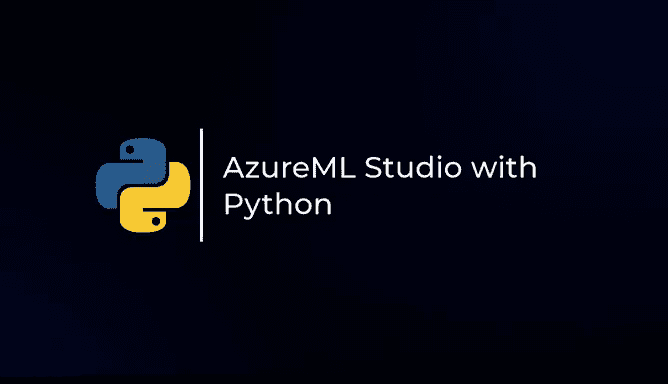
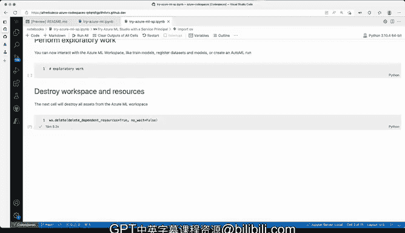

# 杜克大学《MLOps ｜ 机器学习运维（Python基础）｜MLOps ｜ Machine Learning Operations》 - P73：73_05_04_使用Python操作AzureML-Studio.zh_en - GPT中英字幕课程资源 - BV1kw4m167aV

。

Now that we have the Azure ML core Python SDK installed， we're going try to interact with it。

 So I have this Jupyter notebook here and you can see here that I have a couple of more than a couple but required required secrets。

 the subscription I the Azure service principle10 end a principal app I in the principal password Now if you've created a service principle then this will be very useful to you otherwise you can try without a service principle and doing the authentication without it。

 So in that case you would only need the subscription ID and then you have like a dynamic logging being prompted So that's always of course an option you can see here that I'm I'm not having secrets here or anything like it however with this R one which has a service principle I definitely will and。

One thing that you could do is if you have if you're using something like codespaces。

 like Github codespaces， you will go here to the repository settings and you can see here that I have Azure service principle app。

 the password， the subscription ID and you can create those and then you're good to go so finally when I want to show you is the portal where I have Azure machine learning the service and I only have these base ML。

 which is something that I use sometimes to do demos and to try new things Now our goal is going to be to create a new instance of the Azure machine learning studio I'm going to create some compute and I'm going to check it out so and all from these Python SDK so let's go ahead and get started I've already as you've seen before already installed the dependencies I'm going run these this should already work I have my subscription ID tenantant I service principle app ID in the password and now the optional ones you can see here that demo try Azure。

MM is the one that is going to default to I haven't explicitly said those。

 So we'll see what happens next。 Now we're gonna define the service principles So you can see here I'm installing stuff or requiring actually importing stuff from the Azure Ml core。

 I'm going authenticate。 That sounds good。 I'm going run that。 complete it。

 Now I'm going to create the workspace right So this is what's going to show up in the Azure portal。

 So I'm going run this And this is going to take a second。 So let's wait until this completes。

Okay so this has completed and you can see that there's a lot of things that were deployed。

 storage account， key， app Ins， an R keyboard， workspace and an R storage account。

 there's a lot of stuff going on。 So let's take a look at the portal。 So if I refresh this。

 There you go demo try ashure MLl is there。 Now I'm going to click here and then I'm going launch ash machine learning studio and I'm going to let this load that's fine。

 This is that default default view that's fine。 I'm going go back here。

 and we haven't done anything other than create in the workspace。

 but now I want to create some compute targets in some cluster。

 So I'm going to run this cell and let's try to see if you can see there is in progress and it's going to take a second。

 so let's wait it out a few seconds there to finish。

Okay so these completed and you can see here in the code I had like wait for completion show up with true。

 So that's why this was kind of like blocking。 So it went on the loop。 I defined my compute。

 I created a CPU cluster with a standard DSs3V2 and idle seconds before scale done so like a little bit of configuration。

 but this already shows you the ability the capacity。

 you have to use the Python SDk with ash machine learning studio and start creating things programmatically。

 Now in here you would do some exploratory work。 but before we even attempt to do that and then later destroy the workspace and resources。

 let's take a look at what happens on the studio。 So here I'm gonna go all the way to the compute section。

 you'll see that there's nothing available right this might be kind of like surprising。

 but we haven't created a compute instance we created a compute cluster。 So let's take a look here。

 there we go。 we have our CPU cluster。 if I go back quickly to our editor you can。

See here that we created。 this is the name right here。

 the key of that dictionary is that CPU cluster。 So if we go back。

 you can see that standard DS3 V2 ES US2 was the thing that we actually went ahead and created。

 So then again very nifty way of creating you can see the estimated cost and you can see that there's a lot of stuff going on here。

 So again， this is all using the compute。 So now you lose some exploratory work。

 you lose some some work here and then you're done and you want to actually get rid of everything。

 So that's an important way to avoid coming into very potential high cost。

 So lets let's run this and see what happens。Alright， so that took very， very long time。

 So that's kind of actually unusual in this case， it took 90 minutes and5 seconds。

 This is not very common。 So probably something going on with the Azure cloud as a provider who knows what's going on in my experience this usually takes just a couple of minutes and then that's it So it says it has a straight workspaces and resources Now what does that mean exactly well。

 if we go to to our resources。 remember this is the cluster that we had created and I reload it'll probably tell me that there's a 404 of course because there's no there's no demo cluster demotry Azure M so you can remember also that the name was demo try Azure M if I go back here and I scroll all the way up you can see I had CPU cluster and demo Azure M comes from。

Right here where I'm saying that that's going to be the resource group and the workspace name。

And that's how it's going to create this service Now if I click here and close you'll see that I have these two available if I refresh demotry Azure MLl is gone So there you go that is how you will interact with the Azure machine learning Python SDK to connect to Azure Machine learning Studio bring up infrastructure and at the very end I'm going to scroll very quickly here at the very end the destroy Workspace and resources to avoid overcharges to your account。

