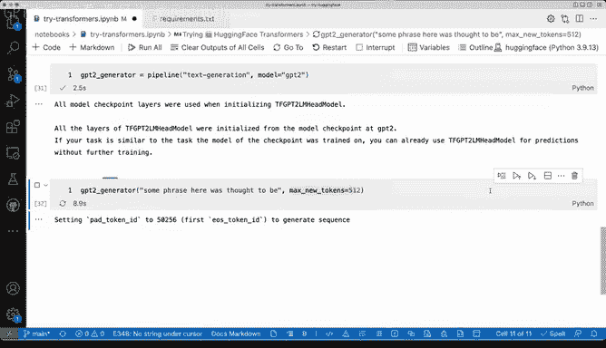

# 杜克大学《MLOps ｜ 机器学习运维（Python基础）｜MLOps ｜ Machine Learning Operations》 - P74：74_05_05_Hugging-Face-Transformers.zh_en - GPT中英字幕课程资源 - BV1kw4m167aV

。

Now let's take a look at the Huging phase Huging phase is a company that builds a lot of As and packages for machine learning In this case we're going to take a look at transformers this is a hugging face documentation page for Transers and we'm going to be doing a little bit of machine learning exploration with transformers and it allows you to do many。

 many different things text images， audio and other things as well So we' going to interact with it when install some dependencies and see how it actually works so I have here a Jupyter notebook I've already installed the dependencies and let's take a look at that in the requirements that text file that I have over here so transformers is installed by Pip like Python installation tool and as always try to install it in the virtual environment I'm going to use version。

4。21。1 I have other dependencies here like i widges and i kernelnel those are related to using Jupyter notebooks but are optional in case you're not using a Jupyter notebook to do some exploration Allright so let's go back to the Jupyter notebook over here and first we're going to start by importing pipeline so pipeline is a helper that will allow us to do a little bit of interaction with models I'm to run this if you've successfully install transformers the Python library for hugging phase then you would refer to it like this in this import statement All right next we're going try these。

Text to text model， which is one for NLP processing。

 So the way you do these is you call it with the pipeline helper and then you specify what the version of the or what the actual model is。

 So we'm going to run that。And this is going to produce the model。

 the model object when you do for interaction。 So we're getting a lot of warnings because you have the ability to set certain certain parameters when you're dealing with that so you can see here that a model max length is one and if you want to fine tune。

 the output， you will need to change those。Allright。

 so what is something that we can do with this generator object that was created。 Well。

 we can do all kinds of things specific that are specific to this model。

 but do you notice that I didn't actually loaded like an existing in file model if I scroll away up here all of these are loaded dynamically so there's no need for me to specify a model that is on disk and is local to my machine so this is perfect for exploration and tingra I'm going run here a summarization so you can see here that that this is the text and I can pass it in and it's a single string。

 but the API for this particular model tells me that I need to use summarize column and then the actual phrase so theyll get me the generated text machine learning is a key to a successful production environment a foundational process so it was able to go ahead and summarize all of。

Allright， but that's not the only thing that we can do here with this model。

 we can do sentiment analysis。 we can see here that this is positive or automation takes hard work but allows you to have solid deployment。

 well that sounds positive and the sentiment analysis I mean there's many are models that do sentiment analysis of course。

 but these one has the ability doing all of these as well it can also answer questions so it's kind of like an only in one model right it's deploying models into production hard。

not entaillement， not exactly a very good answer to that question and even some translation we are going to do translation from English and French and you can see that that actually works All right so I show you how to load a model but we didn't necessarily do other models and that's what I want to show you next here with these GPT2 generator so again when I use the pipeline helper when I say that when I do some text generation and the model is going to be GT2 so Im going I use GP2 behind the scenes when I load that so behind the scenes it's downloading the model and before doing the predictions。

 I mean I didn't show you my network status here， my local computer but it was downloading everything so that we can interact with it now we're going to generate generate some text based on these。

Initial phrase， you can see here that now I am going to be using the max new token。

 so let's run that。And this is going to take a couple of seconds here to generate。

 but the initial loading of the model will take a second Allright so that did take quite a while it took 38 seconds actually but you can see that it generated a lot of text here so some phrases here was thought to be and you can see that's kind of like the prefix and it derived into Christians and Islam and a lot of history here it seems so pretty interesting you know the ability of being able to load dynamically models and interact with them is very useful and this is not the only thing that you can do of course you can set up and build APIs which will see later on but these sets of foundational knowledge on how to interact with models that are loaded dynamically with hugging face。

