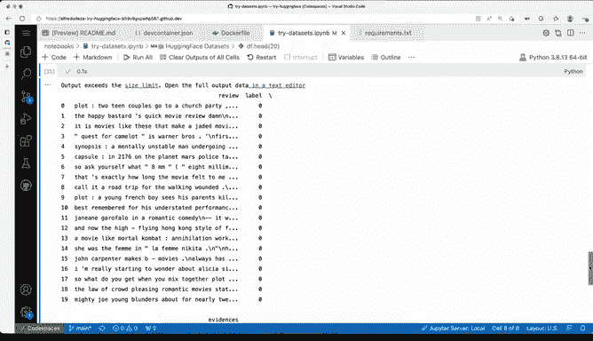

# 杜克大学《MLOps ｜ 机器学习运维（Python基础）｜MLOps ｜ Machine Learning Operations》 - P75：75_05_06_Hugging-Face-Datasets.zh_en - GPT中英字幕课程资源 - BV1kw4m167aV

。

Another core piece of the hugging face libraries are the datas one datas is a library for loading datas dynamically I mean similar to other dynamic loading libraries like ash or open datas。

 hugging F datasets allows you to retrieve dynamically any datas that is in hugging face now all those will be stored on the hugging Fase hub so the Huging F hubub is the one that kind of like holds everything it's you know kind of like GitHub what GitHub is to programmers hugging faces for sharing datas and machinery models and other things that you can do including fine tuning your models but so this this is the documentation page and you can always refer to that。

To find a little bit more， but let's take a quick look at how that looks， how that works dynamically。

 so I'm going go here。 I'm going to close this terminal。

 So this is a Jupyter notebook I'm running Python 38 this will probably work your Python versions as well but I am essentially just going to play around with huggingface datasets Now this is the notebook and the first thing I'm doing is I'm importing from datas So datas is the actual library we want to install but before we start here。

 why don't we go and take a look quick look at the requirements because looking at the requirements should give you a good idea of what what we're dealing with So i widgets and i kernel those are for Jupyter notebook so that's not really relevant What's relevant here is datasets so I'm using 2。

4。0 here and。Transformers is more for you know dealing with the actual models and loading the models also dynamically。

 which is pretty nice， but for effects of this demo it is right here it's data sets that's what we want to focus in Alright。

 so let's go back to data sets let's go to start executing some of these cells So I've imported a couple things load data and list data So with load data。

 well it will allow me to effectively do that load a data dynamically inlist datasets because I want to show you how many there are。

So the available datas you can do that with least datasets right here and what I'm going to be doing is I'm going to show you absolutely everything there is。

 all of them and then I am going to just give you like like a preview of all of the data sets that are coming from hugging face itself。

 so that means anything that doesn't have a slash in it if it has to slash means that some user uploaded a dataset I'm going to run these an executive cell。

 so you can see there's 9009000 datas that are available。

And these are a few of the ones that you should be able to get access to that are coming directly from a hugging phase and not from a user you can see。

 you know there's all kinds of things here。 Amazon polarity。

 Amazon reviews is like a good a good one。 There's multi。

 I don't know what the difference between multi and US reviews is but those those are very large datasets。

 All right， so you do have access to a ton of a ton of datasets as you can see here。

 I'm going to scroll down， sorry for the wall of text So how do you load one well you find the one that you want to load and you load it by name。

 So it's it's pretty straightforward。 So say， for example。

 we want to download or load actually the movie rationales here in this cell So we would do that by passing the movie rationale string。

To the low data set function。 So I'm going run these。And it didn't take much。

 And the reason why is because well I had previously run this so it cached the you can see here there's there's a home vs code that cache how in face so that's a caching key What this means is that if I run this cell again it won't it won't it will take zero seconds because it's already there it will just find it and prevent you from keep downloading the same data set。

 especially this is useful if you have very， very large datasets that you're dealing with。 All right。

 so what does this look like。 So if I run these it looks kind of like a dictionary。

 but I first was confused because I thought without reading the documentation that this was actually a data like say for example that I could just work with pandas but it isn't there's three keys here you have train validation and test So the nice thing about。

Is that the dataset is already split into three These three items are features actually sorry train validation and test which you already went through and you can see how many rows so that's also useful because you're getting a quick preview of what you're gonna to be dealing with So the test data has only 199 the validation 1200 and of course the training 11600 and you can see the features that are coming already with each data so here you have review label and evidence and those are the same regardless of which one you're getting so okay so that's good right there that's excellent you can have the ability to load each one of those specifically but let's select the train one and thens which is effectively just a plain dictionary let's。

Grab that train and let's make a go to panda。 So it has the ability to create a data frame object。

 And then you can actually work with it with pandas。

 So here we have 1600 you can see that there in the in the count。

 So if you remember if I scroll way up here， you can see here that the number of rows for the train for the training data is 1600 as well。

 So so that confirms that what we're seeing。 but you can do I mean all kinds of different things here。

 we can do let's take a look at the head and let's say 20 items and let's describe that let's let's take a look and you can see here well we have the review。

The you know， a little bit of the text here and what label that that is and there's evidence is。

 I mean， there's there's a lot of there's a lot of text here。

 that's why it doesn't show all in my text here。 you can see there that exceeds in the output limit that's that's the reason why。

All right， so so there we go， that's how we load datas with Huging face if you wanted to have like something like a user based。

 like if you're uploading your own datasets， you could and then load them dynamically why would you want to use these well because you don't necessarily want to include huge datasets in a Gihadripo actually there's a limit you want to load them dynamically so that the storage is someone else's problem and you're able to poke around with with big datas that you're not necessarily making part of your repository。

