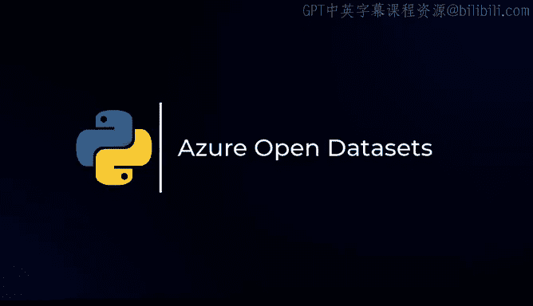
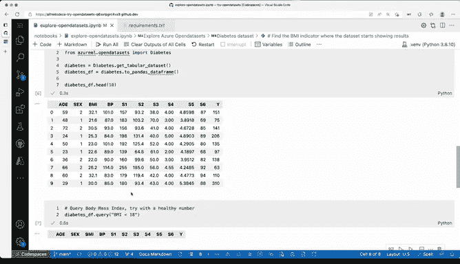

# 杜克大学《MLOps ｜ 机器学习运维（Python基础）｜MLOps ｜ Machine Learning Operations》 - P76：76_05_07_Azure-Open-Datasets.zh_en - GPT中英字幕课程资源 - BV1kw4m167aV

。

Now let's see about Azure open datasets， open datasets similar to hugging phase and its datas offering allows us to install the library and then load these datasets dynamically so we're not going to have to have all of those heavy datas in a repo for example。

 so here it's kind of like the documentation， the overview of what it is and it tells you kind of like how how everything my work when you're trying to interact with Azure open datasets so not only they are curated and prepared which gives you the ability to load them dynamically as we've seen before with hugging phase。

 but it does allow you to interact well beyond that because it has tons of examples included in the documentation。

 we'll take a look very quickly here at a couple here has the public holidays and it has Azure。

s so we can take a look at that and in the Azure notebooks you have notebooks for a lot of them I already was browsing the New York City Tax and the Mu Commission which is a pretty popular data that you might be familiar with and not only it gives you like a good overview but it allows you to read more about the nature of the data so here you can see some columns and what that might look like even with a little bit of description All right so that's a very quick overview how do you get started how can you use it well let's hop over to our repository over here I first want to show you the requirements and this is what we're going to be installing it is Azure ML dash open datas and the version that we're going to be using here is 1。

44。0。So let's hop over to explore the open data sets。

So what you will need to install the package here we have like requirements that text and that would be Azureml open datas and the version is at 1。

44。0 So if you want to try this out that's the version that you need to install Now let's take a look at the actual notebook All right so these notebook will' do a little bit of exploration of the data right so we're gonna to start by loading the public holidays the way the way you retrieve that is importing from Azure Ml that open datas I'm going to get the public holidays over here we're gonna to have some utilities here because the public holidays deals with dates and Python has a few nifty helpers there to deal with dates dates can be kind of tricky So I' going to start thereby defining on line8 today so daytime that today will give you like the today object and then last year and this is where relative delta becomes very useful you can say。

Well I'm going subtract today from by 12 months， so now I have the relative delta months 12 and so that's last year so this HOL short for holidays will be the public holidays data set remember we import that from LangWine one and then we' to say the start date the last year and the end date today so we'm going to have a full year worth of holidays and then we're going to put it to do an object that I want to play with pandas so I'm going to do that。

All right so that took a couple of seconds there to load now I previously run these and that allowed me to have it only in three seconds。

 but if you run it from scratch， it won't take three seconds it will probably take quite a bit more it depends on the size of the dataset now we can start playing around with it because we've loaded that data assay pandas data frame and you can see here that that describe allows me to have all of those nifty pandas features let's take a look at the actual data with the head there when I say 10 and it it gives you the country or region so you can see here England。

 Sweden， Canada what's the name of the holiday it does some normalization here it seems you can see here late summer bank holiday England Wales and a little bit something else there but it normalizes to late summer bank holiday。

I pay time off I mean very， very complete and you can see you can interact with it with pandas。

 The one that I want to show you because I don't only want to show you this one with the holidays is the diabetes set that's also available from open data sets and you have these nice consistency we have the describe there we can actually try instead of the describe we can do the head so we can we can see how how that looks。

 let's get the first 110 items and run that instead of the describe there we go we have hs Bmi blood pressure and I think there's other types of blood pressures here I believe and we're going to play around a little bit with the Hs and Bmi So let's query the body mass index and try with a healthy number right So what if the Bmi is less than 18 So less than 18 I mean you。

prettyty healthy there with a BMI and so you can see here the diabetes doesn't have anything to show let's try a little bit with you know 19 going a little bit higher and you can see that we are getting like a few more So you know that keeps going up I think if we go by 30 then we'll get quite quite a lot more there you go 300 over 300 entries there So you know that's it that's Azure open data sets very useful to load other curated data sets dynamically。

