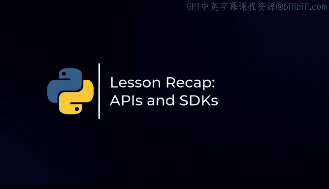

# 杜克大学《MLOps ｜ 机器学习运维（Python基础）｜MLOps ｜ Machine Learning Operations》 - P77：77_05_08_课程回顾-API与SDK.zh_en - GPT中英字幕课程资源 - BV1kw4m167aV

。

In this lesson we were able to cover a few of the APIs and SD cases that you might interact with in a day to-day basis some of the concepts like loading datas dynamically is essential because it allows you to interact with datas that are huge and that it is not feasible to include them in say a GiHub repository this gives you the capacity to interact and deal and tinker with data in your process so that you can build automation on that then we saw a little bit of the hugging face API and we interact it a little bit with the library and we understood how to install it and work with it similar with the Azure open datas and the Azure CLI。

