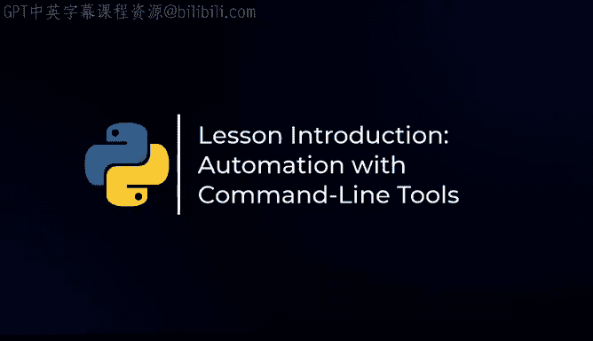

# 杜克大学《MLOps ｜ 机器学习运维（Python基础）｜MLOps ｜ Machine Learning Operations》 - P78：78_05_02_课程介绍-命令行工具自动化.zh_en - GPT中英字幕课程资源 - BV1kw4m167aV

。

Let's see how we can build powerful command line tools with Python This will allow you to take your automation to the next level we'll see some of the different strategies that you can apply。

 including like a single file a single file script or if you want to have something more advanced and you want to declare your dependencies we'll learn how to do that including packaging so that you can distribute your command line tool somewhere else and lastly we'll see how we can apply these concepts of building a command line tool to solving a machine learning problem。

