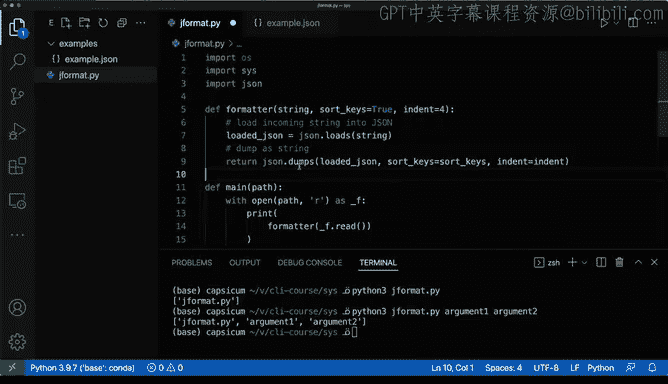
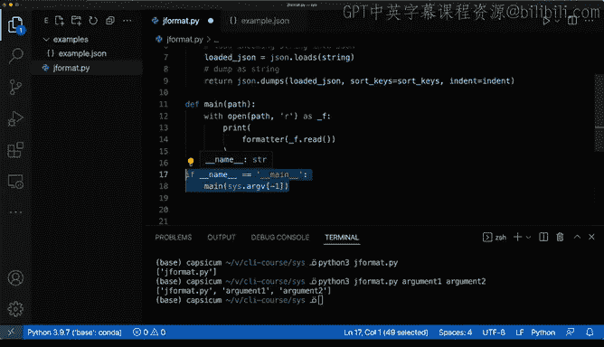
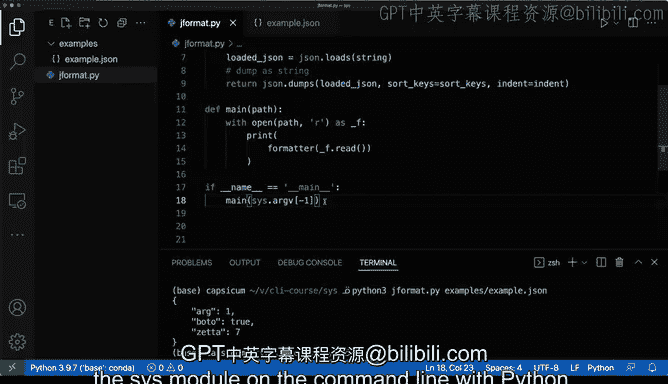

# 杜克大学《MLOps ｜ 机器学习运维（Python基础）｜MLOps ｜ Machine Learning Operations》 - P79：79_05_03_创建单文件脚本.zh_en - GPT中英字幕课程资源 - BV1kw4m167aV

。

So what we have here is a very small script with a main function and a helper function here called formatter and all that it does is it accepts a single argument on the terminal on the command line and that command line argument is a path so all that is doing is opening that path reading that and formatting so it's expecting some J adjacent file and I have an example file here which looks you know very inlined and we're going to format that nicely we're going to use Python for that So we're going to use this as a basis for our examples Now we're going go back to our J format that pyfi here and the trick that we're going to use here is we're going to use the cis module but before we use the module we're going print out what what that method specific method that we're going to use the module from Cs is going to be doing so we're going to save that and then we're going to execute。

Python J format so that he can tell tell us about what's going on so it is going to use is going to retrieve at least from what's going being passed in the command line in this case is the first argument it's always going to be in the name of the script so if we pass many other things so we would say for example。

 argument 1 and argument 2。And we pass that。 we're going to have a list with argument  one argument  two separate items in this one list。

 So first trick to use as a simple， very simple command line tool is using the sister Rv module and we're going to use these in order to pass the arguments。

 Now in this case， we only want to pass consume one argument and we'll see how we can do that。

 But we're going to use this really horrible thing in Python that allows us to convert these to a tool that will be able to handle things on the terminal。

 So we're going to do if。Under underscore name。Is equal to underscore underscore main and。

The condition is going to allow us to pass in this thing to mains。 We're gonna to use main。

Andm going use sayss that R V。 And then we're going to use the last argument in that list。

 the last item in that list to main。 So we're not caring about how many arguments are being passed in the command line。

 We are only going to select the last one。 in this case， that will be argument number2。

So with that that's going to go into the main function on line 11 and that's going to use the formatter to read that example that JSON file that we have over here and nicely formatted with the JSN module you can see here I'm using JSON that dumps and that will allow you to use all of the things that allow you to reformat that nicely so again you need to use that this if underscore underscore name equals main so that we can trigger these thesees conditional license or avoids side effects when only when you're running on the terminal as a command line tool if you're importing the code you will be allow to import formatter or even import main without any side effects。

 but if you're running this on the command line then this condition will get affected。

So we're going to use the terminal here and I am going to now run with Python 3 J format and use the examples that Json。

So that's it that is formatting our arguments。 So what is happening here。

 the last argument in that are going that are being passed in as in the terminal and in this case that examples slash example a is being passed in domain as the path then we're reading that and then we're printing and results from what's coming off of the JSON module which is nicely formatting and again our example that JSO file looks very。

 very different so that is how you parse a single argument with the cis module on the command line with Python。

