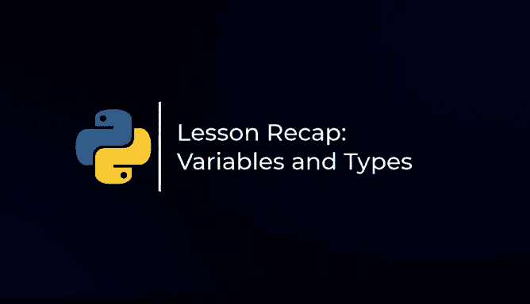

# 杜克大学《MLOps ｜ 机器学习运维（Python基础）｜MLOps ｜ Machine Learning Operations》 - P7：07_01_07_课程回顾-变量与类型.zh_en - GPT中英字幕课程资源 - BV1kw4m167aV

。

In this lesson we saw how we can assign variables， work with different types。

 and do a little bit of logic and find our way around logical statements and evaluations of certain conditions and finally we took a look at the exceptions and how exceptions work and how we can handle them。

