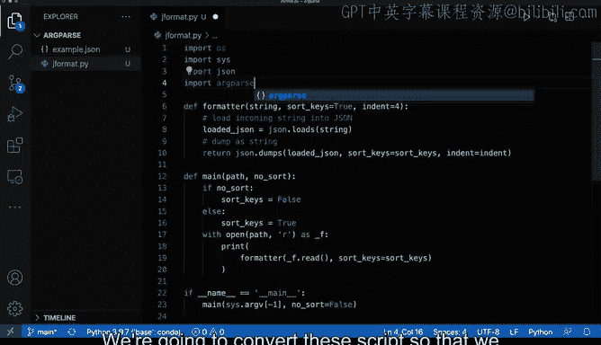
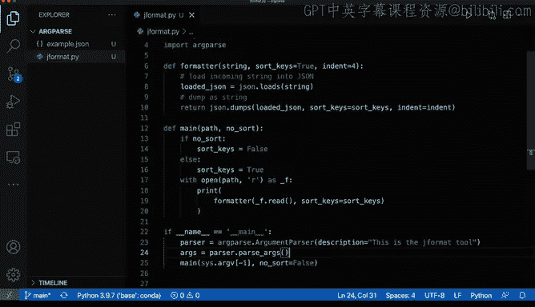
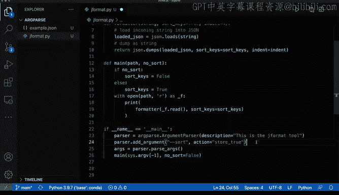
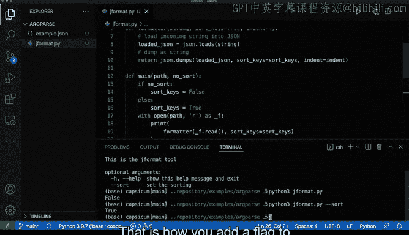
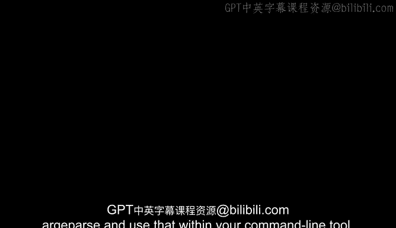

# 杜克大学《MLOps ｜ 机器学习运维（Python基础）｜MLOps ｜ Machine Learning Operations》 - P80：80_05_04_使用argparse框架.zh_en - GPT中英字幕课程资源 - BV1kw4m167aV

。

嗯。We're back with our J format script as an example to work with and we're going to use Arc parse here to create a parser now Arc parse needs to be imported。

 so we're going to do that。And we're going to convert this script so that we can start seeing how to work with Arc parse effectively。

 so you can see here in line 23 where solutions is that RV that's fine we're going to handle our parser right here writing these if condition on line 23。

 So we're going to start by initializing these class that is going to come from A parse。

And that is argument， parser。 That's the class。 And we're going to add a short description of what this program does。

 This is optional。But it's going to give us a help menu for free。 You will see that in a second。

 So here we're going to say this is the J format tool。And it's a short description。

 I'm going to save that。 And next， we are going to say as。Equals parser， the parse。As。

 and that's a function。 And we call that。 and that's fine。 actually a method。 And that's fine。

 We're going to call that。 And that's it。 That should allow us to call these script on a terminal and give us some options。

So we're going to open up the terminal and see how this works。

 I'm going to call Python 3 J format Dt Pi and passing a dash H。And if I pass that。

 Arc parser is going to recognize that this is the help menu and we are getting these optional arguments at the bottom like dash H and dash dash help show this help message and exit and it is using that this is the J formatmat tool message that we added in the description here on line 23。

That's it， that's all that you need to do to initialize to get started with arc parts and the reason why this is a whole section on these particular two lines is because even in the documentation this is very hard to get to and you don't get the examples until very later in the documentation so it might not be super clear but this right now is allowing you to have like a full fleshed out help menu with two lines you're importing and then initializing the argument parser and then calling par arcs the method and then that's it like you don' you don't need to do anything else。

Now that we have our argument parser instance here on line 23。

 then we can move on to creating a flag。 We're going to need a flag that deals with no sorting。

 if you remember we're doing this true or false thing over here in line 13 so that we can sort the keys of the output so we can actually use the power of argument parser so that we can handle that as a flag Now this has some options that you need to pass when you instantiate the parser。

 but we'll see how that works。 so effectively you need to use parser again and then add an argument。

 regardless if it's a positional argument or a flag you will need to use our argument and what we're going do here is we're gonna say sort next we we're gonna use a dash dash sort here。

 But next we're going say that the action。Is going to be stored true。 This is a special。

 special thing that we're doing here to the argument that allows us to by default。

 say this is going to be a bullan and it's going to be true when it's being used。

 if it's not being used， is's going to be a nu。 And we'll see that in a second。

 I'm going to save that。

And we can also add a help option here and we can say set the sorting。

 and then we're going to save that and we can run our little command line tool again and see how that works。

So we'm going to do Python 3。G format dash help and see what we get。

 and we are now seeing that the dash sword flag is there and our help menu that we added is right there as well。

 but that doesn't tell us the whole story。Now just for demonstration purposes。

 we don't want to get into the formatting just yet because we need the positional argument which is coming in the next section。

 but before we do that I'm going to come in these very quickly there and I am going to print what arcs that that sort is s as that sort is going to be this thing on line 24 so arc parts behind the scenes is taking these dash dash sword and storing it as the property sort onto as on line 25 so with these print as that sort we can we can actually tell what the value looks like So when I call our command line2。

And we are going to call it without any arguments and you can see that now it's a false。

 So if we say if we say dash dash sort that should turn on a true value。

 So we're working now with a boion There's no longer need to set that false or true just by using dash dash sort。

 we can enable that。 So that is how you add a flag to art parts and use that within your command tool。

