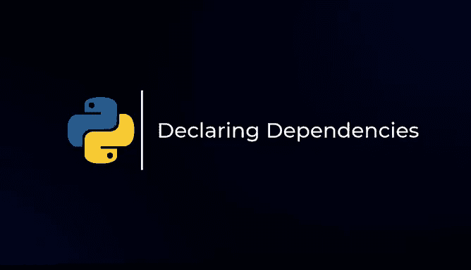
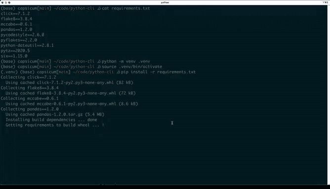
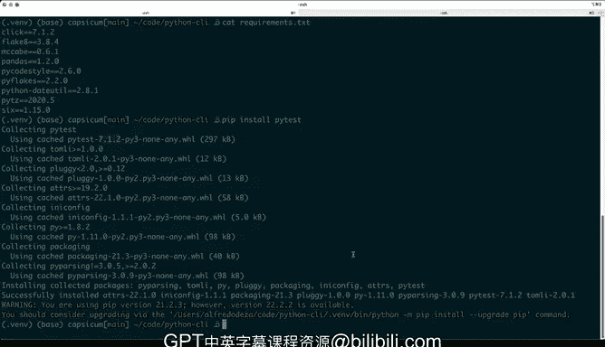

# 杜克大学《MLOps ｜ 机器学习运维（Python基础）｜MLOps ｜ Machine Learning Operations》 - P81：81_05_05_声明依赖项.zh_en - GPT中英字幕课程资源 - BV1kw4m167aV

。

The clear dependencies in a command line tool can be done in a couple different ways。

 but one of the most common and here have a Python project that you can see has tons of different files。

 but most importantly there's a requirements that text file over here。

 so if I do ala if I list the files you can see that file is right here so you may have seen this already let's take a quick look at what the contents are。

So the contents of the requirements that text file like look like this。

 the package name and then the version number in this case with the two equal signs that means that the package is pinned。

 it's pinned to a specific version， there are all kinds of different modifiers that you can have in there。

 and if you don't specify something like in this case the version of 7。1。2。

 then it means that it would install the latest version。

 as always with Python you would want to create a Python virtual environment。

 so in this case we're going to do Python VM for the module VM and then when I do a dot VM for a hidden subdirecty in this same working directory that have and then' going to source VM being activate。

And then that's going to put me into the virtual environment。 So now I can do tip。

 install dash R requirements。The text now Pip is the Python installation tool as you've probably seen in other videos and installation happens in this format once you do that Pip will go through each of these lines that were shown before and it will start collecting each package and its dependencies。

And then it will continue to go and install each one of these different sections。

 so this is going to take a while to install but it should give you an idea of what you should be expecting。

Okay， so this has finished installing everything， all of the dependencies and all of the packages that I listed。

 So let's take a look if we have those packages available if I call Python for the Python interpreter and I try to say import。

Py Tc which I know was installed like right here， I can see that is able to get imported and it is and that's no longer a problem。

 So what would be the difference between a pinned environment and a non pinned environment well if we take a look at the requirements that text again if I were to say install something like。

Let's say P test， which is a framework。 I could do P install pie test。

 That would mean it would be unpinned if I want to pin。

 I would do something like this and I could do you know a specific version like that。

 So if I do unpinned。With just the library name that should just collect the latest available and the latest available version of Py test in this case is 7。

1。2 so that's it， that's how you declare your dependencies on a Python project again there's different ways beyond the requirements that text file。

 but this is one of the most common ones。

