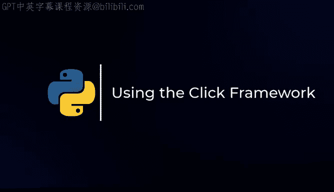
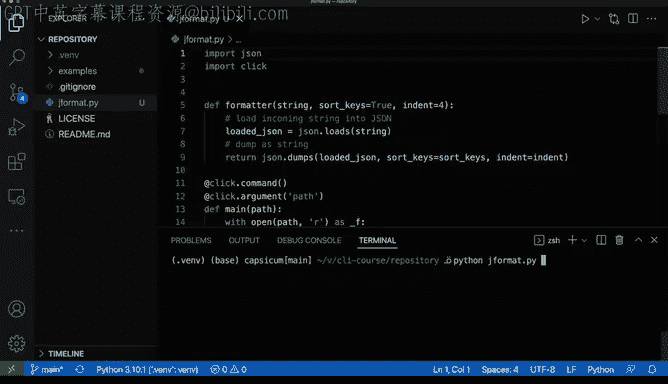
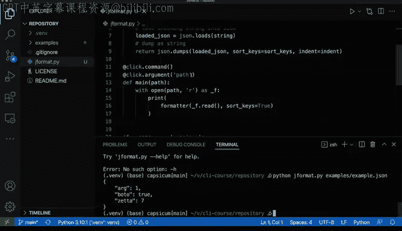
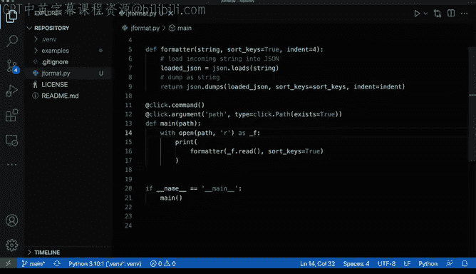
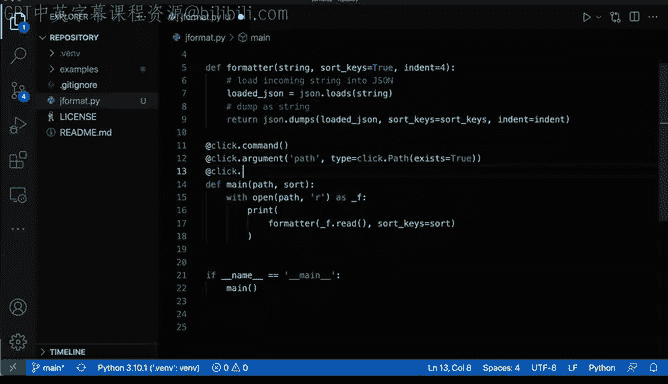
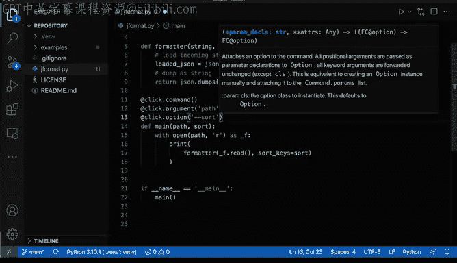
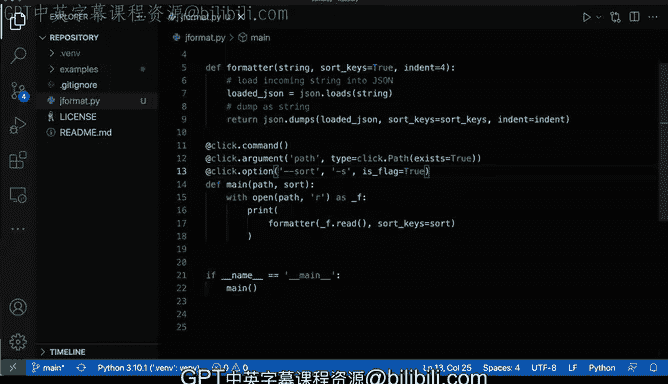

# 杜克大学《MLOps ｜ 机器学习运维（Python基础）｜MLOps ｜ Machine Learning Operations》 - P82：82_05_06_使用click框架.zh_en - GPT中英字幕课程资源 - BV1kw4m167aV

。

So now let's port our command line tool that we've been working with J format or formatter for Json from its simplest usage with C R V to use click。

 So the first thing we're going to do is we're going to import， click。And we knew that there and。

And click should be already installed。 I've created a virtual environment。

 already inact that and installed click。 and this is going to be using click version8。

 it's a major version for them。 So for the project。

 So we're gonna're going to start adding an argument。

 And the only thing that we need to do here is we need to click uses decorators and decorators in Python start with that character over there。

 and we're going to do click command So by decorating the main function。 We're saying。

 hey this function is now a it's a command and it's part of what we're going to be building today and we're going to add an argument。

 So click also uses argument regardless for positional argument or flags and we're going to do argument over here。

 and we're going do。We can do path。And then we're going to say。

That we're going to save that there and we' to see what that does。

 Now by saying path click is going to recognize that in the terminal and then going to pass it as a parameter here it's an argument here to the main function。

 And now instead of using says that RV and all of that stuff here in line 22 we're just going to call that's it。

 And we don't longer need to use the Cs modules so we're going to remove that we're going to going to save these file and now we're going to open up the terminal。

So in the terminal， we can do Python and then J format that pi。

And then we don't pass any arguments， that's it click is handling the help menu。

 it's saying that we miss an argument call path and that we're not passing it in and if we do。

dash age， then it it doesn't recognize that we haven't added any help menu。

 we haven't signal to click that we want a help menu so that's not working and we'll see how that it can get better next but before we do that there are a couple of things that we can do here to make to make this better so this is accepting a positional argument and we can do examples and we have an example that JO file here and that certainly works not a problem because it's passing that into our main function here but one thing that we can do very very nicely from from click is that we can say this is a path so we can pass a type and we can say click that path and we can say exists true。

So what this does is that it tells the command line tool or click the framework it tells it hey。

 we're going going to pass an argument and this has to be a path and it needs to exist so what that does is that if we go and say Python the format that pi and we say for example examples non-existent J is going to complain about it it's going to say hey here in value for path the path Jason does not exist so with just a little bit of extra options we have something that behaves more robustly。

 so that is how I'm going to close this so you can see it better that is how you create I click command line tool with Python and you're adding an argument you're adding an argument。

Over here with the users path and that gets passed onto main So just decing that string over here means that you will get passed into the main function and that is how you add an argument to a click command line tool now that we've added an argument which is path in our little command line tool here。

 we need to add a Boolean flag basically a flag or an option that will enable or disable the sorting Now in click as pretty much everything else it's done with with another decorator but instead of argument we're going to use option so that's the main difference between that in an argument and a flag and here we're going to use dash dash sort。

Now I've added that sort here to main。 That's one thing that you need to do as you keep adding more arguments。

 arguments or options。 you'll need to add those arguments as well to the function that is getting decorated。

 So if this was something else So for example an example well you would need to add that other parameter here and but we one sort so we're going to just keep it as sort。

 Now you can also add aliases and the way you would do an alias is just by keep adding more and more arguments to the option call。

 but this alone doesn't make it a boolean flag。 We need to set a special parameter which is called is flag and then here we're gonna to say it is flag equals true and that makes it a true flag that we're enabling or disabling things。

All right， so that's passing sword and then we're going to pass sword to sword keys now let's save that and see how it behaves in the terminal。

And dashhel is telling us that this in fact now has the sorting options we didn't pass any help menu or any help description rather to sort nor to pass。

 but this is now getting recognized and now we can try if sorting will work so we do Python J format。

Examples example that Jason things are working fine the keys are not sorted now let's use dash dash sort and see if that works and it does work because now arg is coming in first place then Bodo and finally theta so you can see that if I close these this is very very simple I click simplifies a lot when it tries to when it tries to do this you know implement these flags and options and if we remove the E flag you will basically want something to be paired with sort so this is a pretty useful way of enabling a flag in click。

