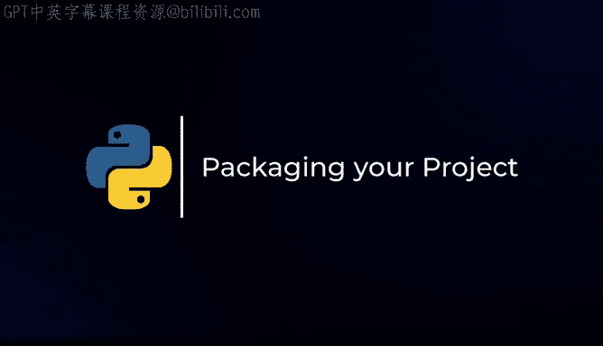
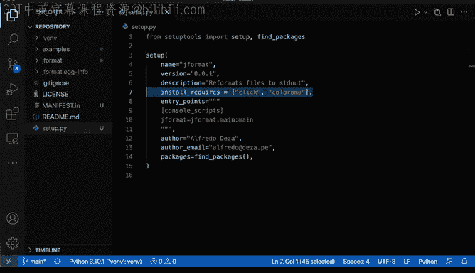

# 杜克大学《MLOps ｜ 机器学习运维（Python基础）｜MLOps ｜ Machine Learning Operations》 - P83：83_05_07_打包项目.zh_en - GPT中英字幕课程资源 - BV1kw4m167aV

。

So now we're ready to start packaging our project。 We have a very minimal set of instructions here with this set of that pie file。

 but it doesn't tell the whole story， and it doesn't because it's missing some things。

 remember we've installed， click and we've installed colorama for the color output。 Now。

 if this was if this was like Nama machine I was trying to share this project out。

 I would get into trouble because these dependencies wouldn't be declared so。

What we need to do here is we need to we need to set some we need to set some dependencies。

 the way you set or define your dependencies in a set of the P file is by adding in a new line here。

 So we're going to add a new line here is's called install in or score requires。

And install requires this takes a list of things。 And we're going to say we're to take click and colororama。

 Now， one thing that you can do there is you can also set like a specific version so you could pin your versions like these。

So you know if this was0 that1 where it isn't we actually in the point at80。

 you could set something like that， but we're gonna leave them like these without without pin versions for now but this is how you define that now you may be asking like what's the difference between the requirements that text that sometimes it's is there well if you're distributing your project。

 you will define usually like with install requirements sometimes people like to read and put like an extra line here where they would read from requirements that text and par the requirements there and then pass them pass them on to install that requirements that's that's certainly valid and impossible too in this case we're not using requirements that text So we're just defining them here in the setup that pie So next which is the big questions like hey。

 we have a directory with some files。Is this a command line tool now， Well， the way。

The way we do that is with one of the ways to do that is with defining entry points。

 So script it's going to define entry points and the entry points needs a console。

Console script section， which will be in charge of creating a specific executable from a particular path and file and function。

 So in this case we want J format to be the name of our executable and we that's going to equals the J format module and then the main file。

 the main by file。 and then inside there， the main function。 So if we if we save that。

We save that and then we go to the terminal， so we open up our terminal and if we do which J format that's not available。

 that's not installed it's not available on our path。

 So the way we're going to do that for development purposes is we're going to do Python set up a Py develop we are in a virtual environment。

 remember and this is going to install the tool in our in our virtual environment。

 So you can see here the whole path and it went and found that we declare some dependencies add a click and install J format script to the repository。

 So this is perfect because now if we do J format。It's there and if we do J format help。

 it is our tool that we wanted to package and distribute date so this is effectively how you package a tool very with just like a minor few options with some utilities like entry points and defining your your requirements in an installser underscore requires argument to the setup function here again。

 you can definitely level requirements that text， but it's not required its optional and in this case setup the works well。

