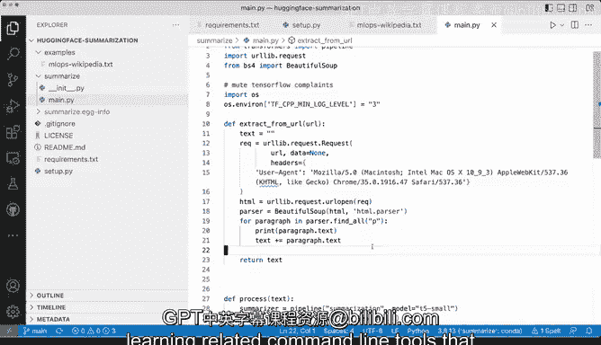

# 杜克大学《MLOps ｜ 机器学习运维（Python基础）｜MLOps ｜ Machine Learning Operations》 - P84：84_05_08_使用CLI工具解决机器学习问题.zh_en - GPT中英字幕课程资源 - BV1kw4m167aV

Let's apply the things that we've learned from command line tools and working with different APIs to try to build something useful for machine learning so we're going to build a command line tool here that we're going make make it a little bit better to work with hugging phase and external APIs to do a summarization so let's start with the requirements and I'm going to be installing transformers here which is coming from a hugging phase than the click framework to provide some of the nice command line utility nice of the framework itself to make it easier to build a command line tool and then a Tensorflow here at the end to help us with the inferencing interactions with the model All right so let's take a look at the setup so again we're going do a Python command line tool to summarize text so the idea here is that we're going to going create this tool so that we can either。

Go to to the web and I'm going to show you one of these websites that I want to do some summarization。

 so this is the ash machine learning model management and deployment with ash machine learning is the documentation from Microsoft I'm going to use this tool to hopefully try to summarize a little bit of what MLops is and additionally we're also going to be looking at some examples So here have text example I'm going open it so this is the definition of MLops from Wikipedia and I'm going to use the commandline tool to summarize these text and see how it goes Al right so that's what we're going to do and let's take a look at some of the other files that are interesting here。

 we're going to go to the summarize application and open the main pie where all the magic is going to happen Allright so I'm going to actually hide these to make this a little bit better All right so we're import and click which is again for the。

Framework command line2 framework helper and then we're going to get the helper from Hugingface which is the pipeline then we're going to do potentially some requests and those requests will use the beautiful soup library the PS4 library will need to get installed for that and we're next we're going to ignore some of the copious amounts of warnings that we're going to get from Tensorflow because I am not in machine that has GPUs so we're going to have some supporting functions this is going to be extract from URL so we're going make a request potentially a request to some URL hopefully the Microsoft 1 and then we're going to parse it and then we're going to find all of the paragraphs and return that text otherwise we are going to process text from well actually this is the process function that is going to do all of the machine learning portion bits of it。

We're going to use the T5 small model and we're going to create that with we' instantiate that with a pipeline we're going to say we want some summarization and we're going to say that the max length is 180 it's going to report what that means as a return and then here the command line tool bits and pieces we're going to say this is a command it accepts a URL or a file and then depending if it's a URL or a file we're going to process a text and then pass it to the process function at the very end and we're going to report it all right so let's open up a terminal we're going to create a new terminal here I already have the virtual environment here activate a con environment。

 it doesn't matter if it's a con environment or a virtual environment we'm going to make it a little bit bigger。

Right， so I am going to do Python setup up up by develop。

 which will install these tool and its dependencies locally and make that tool available to to the command line。

 So now we have the summarizeization or summarize rather script。

 I'm gonna do dash dash help and that's going to load the help menu。 All right， so it did work great。

 You can see here we have the two options， one for the URL and the other one for the file and that's going to allow us to pass in basically the whole URL。

 So lets let's pass that in and we're gonna say summarize dash dash URL and then the full Microsoft there we go。

 We're gonna say the full Microsoft。URl here。 and then when I hit return and then we're going to let these do the processing。

 So there's a lot of output there。 I decided to output the parsing from the website so you can see here while some information and models and datas is automatically captured。

 you can add more information by using text So there's a lot of text that is being processed from that URL So that's going to help us kind of like have like a good overview what is being processed now we are also going to see several warnings from hugging face because I am using the model as is without taking care of the padding and the sequences that I should be properly taking care of。

 but the summarization is complete as you can see here and now we get these nice summary at the very end So it says it's based on devos principles and practices that increase the efficiency of workflows machine learning pipeline can contain steps from data preparation to feature extraction to hyperpar。

T into model evaluation。 So great。 So that was a great summarization of all of these wall of text that you can see here。

 So next， I'm going to clear this out so we can make it a little bit better。 Next。

 we're going to use the summarize tool again this is the summarize tool here。

 takes a second load we're going to use some of the examples。

 if you remember if I go here to examples。 we have this MLlos blob of text So we're going to use that there。

😊，And when to say summarize I say file this time and when I say when I pass the path to it and when I say MLops Wikipedia that text and we're gonna run that again So we should see outputs similar to what we saw when we're running the summarization process for Microsoft Now one thing that we're gonna to see is we're not gonna to see that wall of text。

 So there you go and the summarization is complete and in this case it was MLops or MLl ops is a set of practices that aims to deployment and machine learning models in production reliably and efficiently。

 the word is compound of machine learning and a continuous development practice of DevOs in the software field。

 So great。 that is how you can the things that you can do by building a powerful commanding tool that reuse this existing models in this case we're using the T5 model and we're using a preexisting model for。

😊，Doing powerful summarization， there's definitely tweaks that we can do here。

 especially on mainda Pi， so if we go here， you can see that the summarization the sumr here object can have a better configuration to avoid all of those warnings and perhaps this request can be done a little bit nicer and not just only grab anything that is has a P tag on the HTML so hopefully this is useful and gives you the foundational knowledge to take these tweaket or even come up with a new machine learning command tools or machine learning related command tools that you can interact and build yourself。

