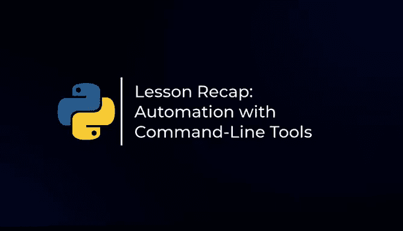

# 杜克大学《MLOps ｜ 机器学习运维（Python基础）｜MLOps ｜ Machine Learning Operations》 - P85：85_05_09_课程回顾-命令行工具自动化.zh_en - GPT中英字幕课程资源 - BV1kw4m167aV

Alright， so we saw different strategies that you can apply when building commandline tools。

 including from a single very plain Python file to， you know。

 more complex tools that might need external requirements， say， for example。

 if we want to interact with the hugging phase API or the SDK。

 you can declare that specific version as you've seen in this lesson。

 Now you're set to choose and pick and choose your strategy。

 best strategy to build powerful commandline tools and take that automation to the next step。

