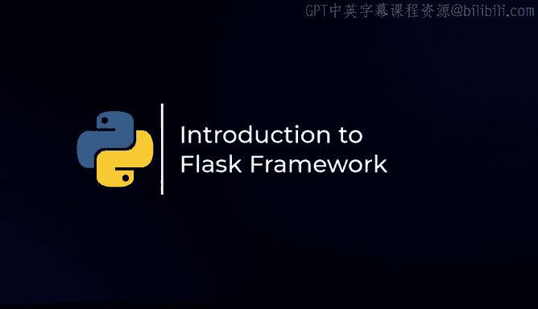
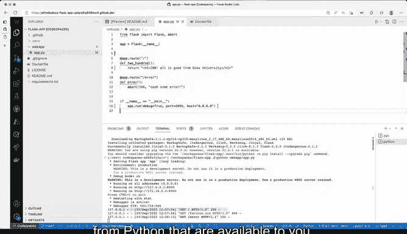

# 杜克大学《MLOps ｜ 机器学习运维（Python基础）｜MLOps ｜ Machine Learning Operations》 - P87：87_05_02_Flask框架简介.zh_en - GPT中英字幕课程资源 - BV1kw4m167aV

。

Let's see how flask works now I have a very， very simple bare bones flask application here。

 it's not even very well packaged at all aside from a Docker file and a containerization process here。

 but I want to show you what an application we're using flask would look like so essentially you import flask well definitely after installing it and we'll see how installing that will work and then you start exposing you start exposing。

Funs like this one with a specific route， So what does this mean this is a decorator that is made available once you define the flask application now I'm using underscore name double underscore but this could be you know anything really could be something like my flask app and that would be fine this is just a very convenient thing to just do underscore name so this is a very common pattern where you import flask and then you create this app object at the very top once that's created in this case I named an app but you can name it anything else。

 this decorator will be available to you and it is kind of like what I'm using here on95 by exposing slash that means that that's the root of the website that would make these part。

icular function be in charge of handling anything that goes to the main。

 the slash version of the website， so that could be something like say for example， my app。

com or example rather example。com s， then if that was my domain。

 then this function would be processing that request。All right。

 so one of the things to note here is that these will replace plain text。

 but you could do you know very rough。Very rough HTML here and then return that and then that's fine。

 Now another thing that you can do is here on line 10 is to you know make an error happen now here I'm forcing the error right and I'm exposing these as slash error when I'm running the application and that's going to be handled with this function over here and you can see here that this application is going to call this function called a board now a board is a helper from Flask that allows me to pass any HttP status here and pass some optional error All right then finally I'm going to run these on any on any IP I'm going to bind on any IP if I'm running this directly with Python here I'm saying for 80 but that's problematic for debugging purposes。

Or running locally， so I'm going to use port 8000。 I'm going to say that。And next。

 let's go ahead and create a new terminal。And so I'm going to create a new terminal here and this is going to run give me a terminal that's perfect as always let's do a virtual environment I'm going to call dot VM and then I'm going to code spaces is going to or actually VS code is going to realize that yes。

 I have a new。A new virtual environment and I'm going to activate that as always and then I am going to I think there's some requirements that text here let's let's take a look at the requirements and this is kind of like the same operation you would expect for any other project really so I'm going to do Pip install that our requirements that text is going to go ahead and install all of those。

Perfect， so if we poke around the Docker file， you' will see that this is just running Python and then that app pi。

 So if I go back to the app pi here that means that this portion of the code is going to get executed。

 So it's going to run with debug equals true。 make sure that you don't run that in production because it's not safe。

 but it's useful for running locally and it's going to bind to 40000。

 So letss let's run that very quickly。 So Python web app pi let's see if that works。

 So that's where you get this warnings don't use this in production and Vs code is recognizing that this is running on 40000。

 so I'm going open that in a browser in a new tab and you can see that the root。

This is effectively slash。 It's that H1 that I did right there perfect is going to work perfectly。

 And then I'm going go back here。 and you can see that fab icon it's a 404 I don't have a5 echo sos that's fine it's a 404 but HttP slash is returning at 200。

 All right so so that's good。 let's try let's try this error right here。

 So I'm gonna go back to these I'm gonna do s error and let's see what happens internal server error some error So these some error text is coming right from here。

 So there you go。 that's kind of like a basic， very basic overview how to instantiate how to create a app with flask。

 how to expose some functions， how to do some errors and how to run it in this case I'm just running with Python know more advanced flask applications might use like a。

From web servers， like say for example， Apache or NGX or any of the other fancy HTTP servers from Python that are available to you。

 but it's up to you to the site， but this should give you like a good idea on how to run it。

