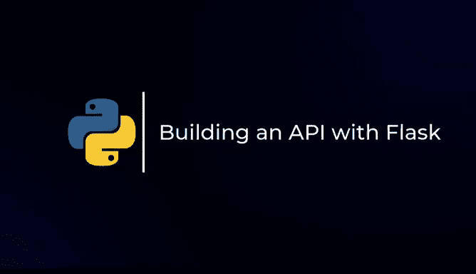
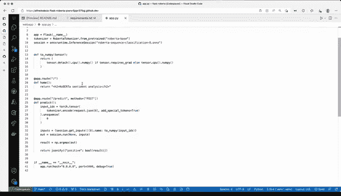

# 杜克大学《MLOps ｜ 机器学习运维（Python基础）｜MLOps ｜ Machine Learning Operations》 - P88：88_05_03_使用Flask构建API.zh_en - GPT中英字幕课程资源 - BV1kw4m167aV

。

Now let's go ahead and create an API using Flask。 we already saw a little bit on how that works with the previous video where we went through some of the application things with。

That flask provides you， but here with the app Pi we are going to do a few different things we're going to use the Onx runtime I really like Onyx and it is something that we will cover later in this course but OnX is effectively a runtime that allows you to deal with models that they can be coming from other places or two other types of framework so as you already know we're going to start instantiating these on flask online number eight this is very very useful right here that's how we get started with our application next we're going to do some require things with that Onx is requiring to interact with the model so we're going to create a session and all of these happens right here at the very。

Beginning because that's needed as soon as the as soon as the application is running。

 then we're going have a helper， this is called a2 nuy helper function here that is's going to verify I have a CPU or why if I don't have one it's going to just figure out what is it that we need like we're going keep our our very basic。

HtM there with Roberta sentiment analysis we're going to do some sentiment analysis with the Roberta sequence classification model and next we're going to expose route here that is going to be slash predict that's happening right there on the route only the post method is going to be available and we're going to use these predict function right there now next on line 26 through lines 3233 we're going to do some of the the heavy lifting there of the processing on how to send that data to the model and this is not a very good API right now because it doesn't doesn't document correctly where the request is coming from so this is implicitly using a request so if you want to interact with flask data that is coming in。

You would import that you can see request is coming here。

 but it's not being passed onto the function itself so what happens here is that you need to use request a and the JO portion of it it's already serialized here these brackets and the0 index means that is the first item so we're assuming that we're going to get a list and we're going to grab just the first one and next we're going to make sure that。

We're're going to process that and we'm going to see if if the sentiment is positive or negative I'm going to return Jsonfi。

 which is a helper from flask， which is going to allow us to return JON if I scroll all the way down here。

 you can see here that I'm going to use 45000 and bind to any host and I'm going to set debug to true。

Alright， so now that I have those out of the way there's a couple things that you need to know for this one to work Now you can see here that I am using Roberta sequence classification so it requires me to have the model and that's why I have the model right right here so if I've pre downloaded that model it's available in the file system so that's already there it' have almost a 500 mebyte file binary file so that's something to keep in mind。

So now I'm going to open up the terminal， and we're going to see how to。

How to interact with these right so the first thing that we need to do is what we I'm already activated on the virtual environment。

 I'm in the right directory where the onyx model and the ada pi is and I'm going to just run Python Abda pi and that should bring up the flashask application did we just went through right development server I don't want。

 well， let's just actually try it out。 let's open that。 that's that's fine。

 that's Roberta sentiment analysis If I go back to the aer。

 you can see that that is coming from this。Home home function。 And D is the H that is being returned。

 So that's， that's fine。 But what we want to is actually interact with。The predict。

 the predict function here。 And you can see it's only accepting post and it's a slash predict。

 and we need to put some Json there。 Now the tricky part。

 and it's that we need to interact with that。 and we either need an extension on an A like we can install an extension right here or we can do it on the command line。

 So let's try on the command line。And that would be with curl and this is how the whole message would look like。

 So curl x post means that I'm going to send a post request I'm going to see that the content type is application Jason So those are the headers so that the framework understands how the data is going to come in and then dash dash data means I'm going to be sending some a body the body of the request is going to be Jason and you can see here is single quotes。

 then a list or an array and using double quotes inside and that's the phrase that is going to be process to an analyze the sentiment is going to do the sentiment analysis and the URL in this case is local host because remember is binding to anything port 5000 predict。

 So let's see how what happens。 Okay positive is' false it not positive All right so let's try to change let's。

To change that。 we can say flask is a very useful framework。 And I run that and positive it's true。

 So that's that's very good。 So now we we can see we're interacting with with the API。

 So I'm gonna close these and go back to the API and and kind of like do a quick recap of what we've built。

 So we've started with installing installing flask for sure and all the dependencies。

 the dependencies are in the requirements that text file。

But we also are using Gsonfi and a request to try to deal with with the incoming request as well with the request or the response rather that we're going to predict after the prediction happens and the Gsonify specifically happens right here in the response of the prediction and finally we were able to run that as always the flask with these little nifty app that run that allows to pass a certain parameters there and we interacted with it using curl on the commandlan tool。

 but effectively you could use any other type of client like say like Python to properly interact with API that is exposed so that's it that is how you build and interact and work with flask API。

