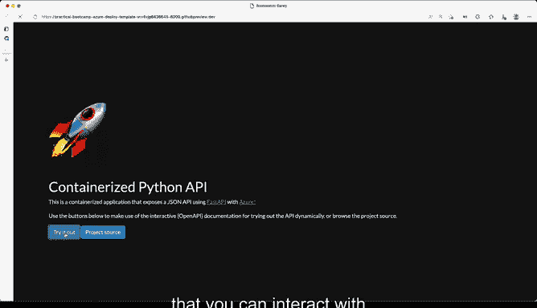
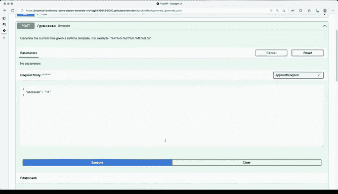
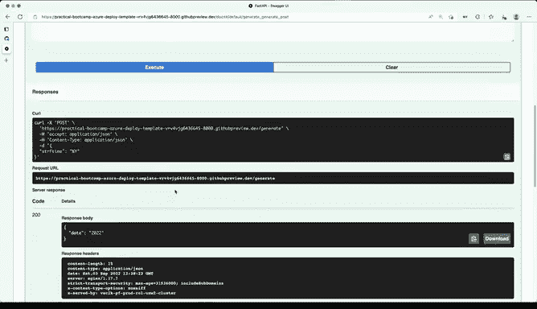
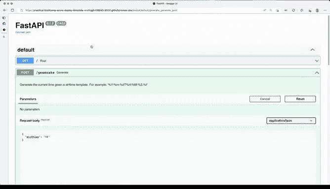

# 杜克大学《MLOps ｜ 机器学习运维（Python基础）｜MLOps ｜ Machine Learning Operations》 - P89：89_05_04_FastAPI框架简介.zh_en - GPT中英字幕课程资源 - BV1kw4m167aV

。

Let's do an introduction to the fast API framework。

 Now the fast API framework is very similar to the flask framework as well but here youll start seeing some of the slight differences and where that where that it makes sense to use one or the other I personally really like fast API and and we'll take a look at how that looks in these quick lessons So let's start with these repository that already tells us that to run this application。

 we will need to use a couple of different things right so it's going to start by telling us that we need Uicorn it's an executable behind the scenes all that it is。

 it's a Python web framework that allows us to run Python application and it can it needs a couple of things first。

 a host， and then it needs to know what is the Python module in this case it will have a mainda pi。

And then we'll have an app function that we can use and let's take a quick look at that file。

 so we' going have these main， so let's open that and close the read me。

And here we have several different files and we don't need this one。

Right there so I'm going to remove that so a couple of different things you can see right here we're instanting these fast API very similar to what flask was doing before so we're creating that app there's some other extra things like this app tab mount that's not important right now basically for introduction app equals fast API we're calling that and we're instant in this and then we are going to expose these routes just like before with flask in this case app that get is how we're going to expose this function。

 this root function just for the root of like the slash the top of the website just using the get method so that's an important distinction before you would use to have like similar parameters that would indicate。

That and then we're going to expose this generate slash generate only for a post for a post request that's how it exposed the this generate this generate function right here so that that is fine but there are a couple of four things that are interesting here mainly these body that is defined here on 919 and it has it has an inheritance of this base model what is going on here well you're creating kind of like an expectation that you' are going to require something that is a field in adjacent body called STRf time and that's going to be of type string that's what STR means there so when that request comes in to the generate function。

You can see here that body is an argument that is required is going to be of type of the body object right here on line 18 so we are seeing a very basic API that allows to have all these things ready for you define the functions。

 the exposure how to start seeing that now a key difference here is that we're using a fire response this has an index that HTML file so if we go ahead and look at static you'll see that there's an index that HTML right there that shows you that you can actually use these to serve some content out now how to run it well it's always useful to poke around the Docker file let's see how that works so it will use UBCn it will host it will be the0 that0 to0 as well that binds to anything and then main that app。

Let's quickly create a terminal and see how that looks and then run it and will that with that being running will complete this introduction to fast API。

So the way we're gonna do this is Uiccorn。 We'm to follow the pattern there on the Docker file instructions。

 so we'm going to do hostt I'm going to do the four zeros right here and then when I say main app So again main app means that it's the main dotpi module and then app is going to be line 14。

 the fast API。 So that's what's going to be running。

 I'm going run that and there you go the started server process waiting for application startup now Vis code is telling me that that 40000 is available I'm going to open it in the browser and the first thing is going to connect and this is the HTML containerized Python API but we want to interact with this API。

 So one of the good things about fast API is that you can interact with the dynamically generated help and that is always at s。

Dogs， as you can see here at the very top that is not exposed。 So if you look at the main。

 I don't have a s docs exposed anywhere。 However， the API does allow me to expose it and interact with it。

 So you can see it right here and you have a slash generate it understand that they're supposed I'm going to click here and I'm going to say I want to try it out。

 Srf time is there。 it's actually grabbing all of the the documentation from my function and putting it there。

 generate the current time giving an STf time template and for example。

 percentage y percentage M percentage D。 So I'm going to try that。

 and I'm going to put it right here， I'm going to see what what this does。

 So I'm going to say why and I'm going to execute and'm going to see what happens。

 So let's scroll here to the responses and see what happens。 Okay， so the response completed it。

 and you can see that the response body is。

2022 that's because percent y it's how Python translates to full the full year。

 So that's a response body， but not only that we also have the full curl command if we wanted to try that somewhere else So that's perfect in also the request URL。

 So critical pieces of information curl the actual URL， the response and the response headers。

 So very very useful preloaded all like with the open API spec that allows you to interact dynamically with the running API So there you go。

 that's an introduction to fast API that's how you can run it that's how you can define some of the functions that are going to be dealing with the input and output and we'll see next how we can interact further by introducing machine learning models。

