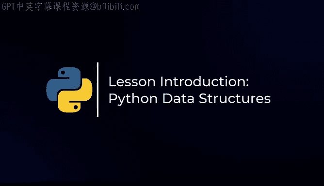
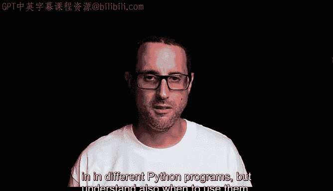

# 杜克大学《MLOps ｜ 机器学习运维（Python基础）｜MLOps ｜ Machine Learning Operations》 - P8：08_01_02_课程介绍-Python数据结构.zh_en - GPT中英字幕课程资源 - BV1kw4m167aV

。

Python data structuress is foundational for writing。

 storing and retrieving data in this lesson you'll learn what some of the most popular data structures or most common data structures in Python are and how to create those and how they behave。

 what are the differences that will allow you to encounter these data structures in different Python programs。

 but understand also when to use them。

