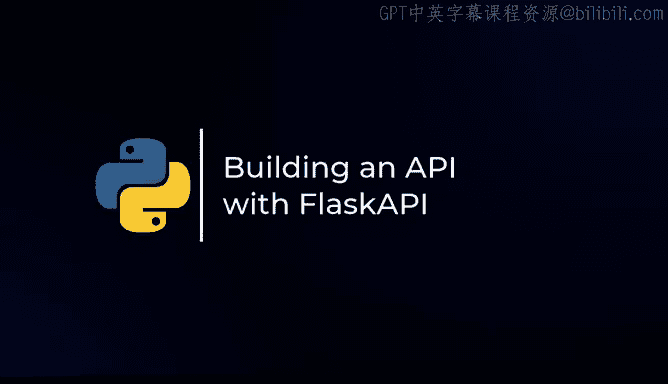
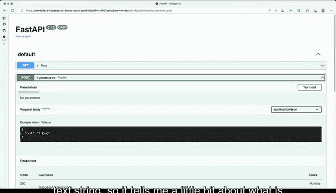
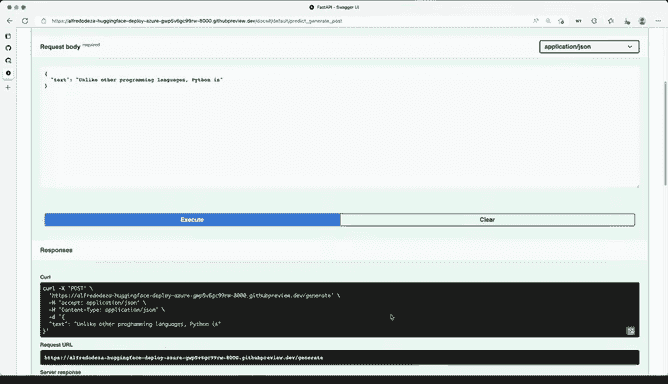
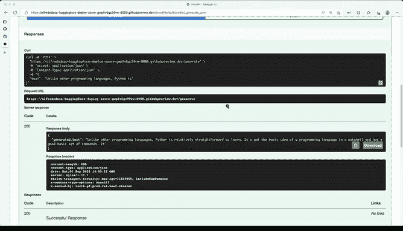
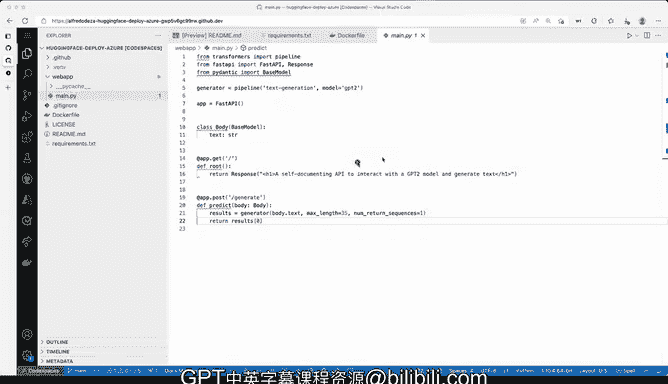

# 杜克大学《MLOps ｜ 机器学习运维（Python基础）｜MLOps ｜ Machine Learning Operations》 - P90：90_05_05_使用FastAPI构建API.zh_en - GPT中英字幕课程资源 - BV1kw4m167aV

。

Now that we've seen how fast API works， let's build a real real world API with fast API using machine learning。

 so with this example we're going to use a few different things let's take a look at the requirements that text here。

 we're going to use hugging phase transformers Tensorflow fast API and UBcorn so you know that UBcorn is how we are going to be running our fast API web application and we're to use Tensorflow and huggingface transformers。

 we're going to be loading a model dynamically so unlike other types of serving models like say for example with Onyx where you actually need the the model to be in the file system。

 this is going to be loading that dynamically so let's take a look at how the main Dpi file is going to be defined so this looks fairly simple。

 straightforward， we're going to define these online line5 dis generator。

And it's going to be using the pipeline， which is a very straightforward forward helper from hugging phase and you can see here pipeline comes from transformers。

 transformers is a library from hugging phase and we're going to define that our task is going to be text generation。

 we're going to use GPT to accomplish that so on line7 we're going to load we're going to create our fast API application。

 we're going to define what that input is going to look like when this case we're going to say text and it's going to be that text。

 the text is going to be the key and the value has to be string。Would't half a root。

Function here that is going to handle everything that comes to the slash to the top of or the root or the main slash of the website it's going to just return some simple simple HTML。

 which I think by the fault fast APIpi doesn't render HTML unless you explicitly tell it to but that's fine because what we're interested in is actually on generate slash generate is what we want we want to create this online line 20 when I use the predict function and we I take a body so very similar we to get the results and then return that result back。

 So this is going to be text generation we're going to produce some text based on an input using GT2 and now let's go ahead and run our little server here with new terminal and when I run it with Ubiorn。

And we're going to actually let's just go to web app again。

 always always good idea to go to the Docker file and see how this is running so you can see that it changes the working directory to web app and then runs that so let's actually run that with Ubiorn So we're going to say hostst is going to be0 that0 that0 and then main the main is going to be the main Dpi the module from Python and app is going to be the application。

 So in this case。It is not found and that is because I didn't activate my virtual environment so you can see right here the virtual environment so I'm going to activate that so that's something that is quite common actually if you're working we're working with virtual environments so let's go back to where the web app is and then run Ubiorn so now it is available because I I used to tap complete and the tap completion work because it is now available I'm going to run that。

And behind the scenes， what Haging Face is doing there also it's actually downloading the model。

 so yes， I want to open this application running for 8000 that was actually pretty quick。

That's a self documentcument API and let's go to s slash docs so that we can interact with that open API specification perfect so that's a fast API right there。

 we had to generate make it a little bit bigger and' to want to interact with it text string so it tells me a little bit about what is expecting on the input and what looks like an output but I want to actually try it out。

So yeah， so I click there text string， so how about we can we give it like a prefix so that the model can do some some text generation so we can say unlike other programming。

Languages comma Pyon is， and I'm going to execute that。 is's going to talk to the model。

 is's going to take a second there to load and hopefully will give me a response back。

 So there you go， as always， it will give me the curl and。

It's going to keep you curl right here， is's going to tell you exactly what the URL was and the response body is going to be right here so unlike other programming languages。

 Python is relatively straightforward to learn It's got the basic idea of a programming language in nutshe and has a good basic set of commands that's pretty good I really like that text generation as always we have to also the response heaters and as well as the body the status HTP code right here and there you go and you can always double check that the endpoint was used correctly so that is how you would actually build a nice API a real worldorld API using a machine learning model with fast API let's do a quick recap on what we have here very straightforward we're creating this base model inheriting from the base model。

Creating the body right there and then slash is defined you don't need to define slash or the root。

 I mean you may， but there is not definitely a requirement。

 but the main thing happens right here on the generate s generate and all of that documentation is handled automatically for us。

